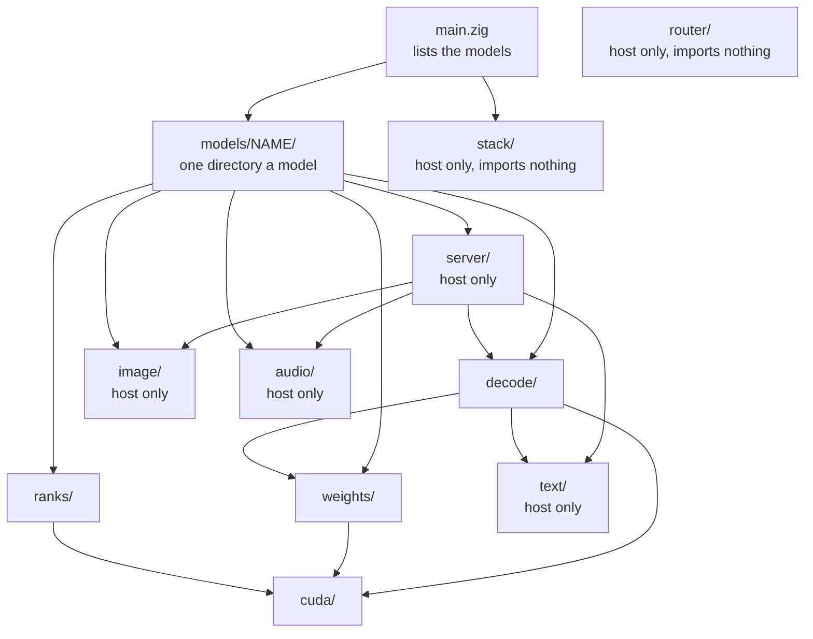
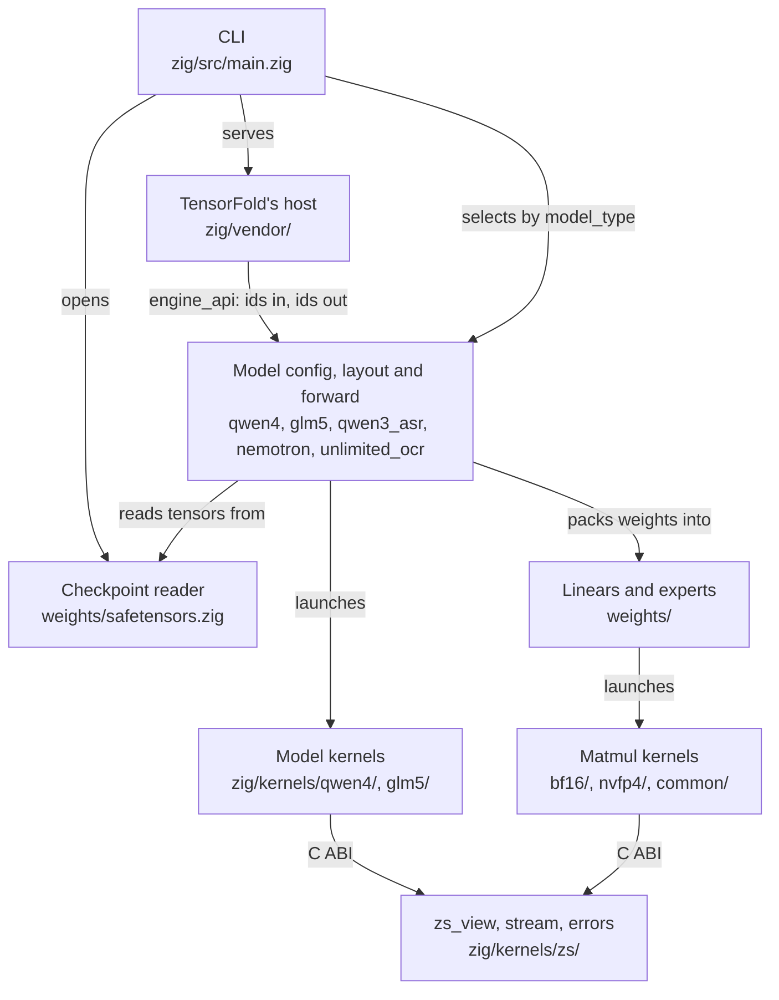

# Architecture

Where a thing goes in `zig/`, what may import what, what a model owes the shared code, and what a change does
so that the tree needs no clean-up afterwards. `docs/naming.md` says what a thing is called; the nearest
`AGENTS.md` says what each file holds; `docs/kernels.md` lists every kernel entry. Written 2026-10-10, after
the tree was tidied once: its rules are those that tidying had to restore, each with what now
holds it.

## What is abstracted, and what is not

**The model is the one dimension.** zspark is built for the DGX Spark and for more models than it has today.
The shared code is generic over a model at compile time and names none; a model is a directory that declares
what the shared code asks.

**The machine is not a dimension.** One device a process, GB10 (sm_121a), unified memory, CUDA 13, two ranks
as two processes over NCCL on the ConnectX link: the shared code assumes all of it and says so nowhere else.
Do not add a parameter, an interface, a fallback or a build option for another device, vendor or memory
model; a kernel is written and measured for this one. What is specific to GB10 lies in `zig/kernels/`,
`cuda/` and `weights/`, not in a model's directory where two models would each write it.

## Layers

An arrow is "may import"; a model may import every layer, and `cli.zig` (a command line's words and a chat's prompt, spec 136 WS-04) stands beside `text/` and `weights/`, importing them and `decode/`, and `server/` imports it for what the models' `serve` checks alike (`server/command.zig`).
The table is `tools/check_imports.zig`'s `parts`, and `zig build check-specs` refuses an import outside it:

- No layer imports `models/`. Only `main.zig` and the tests' roots name a model.
- A model imports no other model. What two models use as it is moves down, to `cuda/`, `weights/` or
  `decode/`, in the commit that gives it its second user (`weights/linear.zig` is one such move, the ModelOpt map
  in `weights/modelopt.zig` another: Flash Next's and GLM's FP4-Local, spec 107; `weights/loading.zig`, the
  load's reader a part ahead and its phases, a third, 2026-10-20; the two ranks' row of logits, settling and graphs in
  `decode/settle.zig` and `decode/graphs.zig`, spec 136 WS-05, which take the NCCL comm as `anytype` since `decode/` does not import `ranks/`; `weights/checkpoint_reader.zig`, a config's
  field readers and a layout's tensor finder, Qwen3-ASR's and Unlimited-OCR's, spec 142 WS-04).
- `server/` and `text/` are host only: no device, no checkpoint. What a reply needs of the device reaches the
  server through the model's `reply`.
- `image/` is host only and imports no other layer: a picture's bytes to RGB and Pillow's bicubic resize and pad (`resize.zig`, spec 137), apart from `text/`
  because it links C (stb_image's JPEG, BMP, TGA, PSD and PNM and libwebp's decoder, under `zig/vendor/stb/` and `zig/vendor/libwebp/`,
  one static library of `build.zig`) and holds pixels, not text. Its PNG and the orientation are the vendored
  `picture`'s. `server/images.zig` is what calls it at serve time: an image part's bytes to the tower's input
  (`engine_api.Vision`), the same name as the vendored host's `server/images.zig`, which calls it.
- `audio/` is host only and imports no other layer: an audio file's bytes to the 16 kHz mono samples and the
  log-mel features a speech model reads, apart from `image/` because it holds samples, not pixels,
  and links the vendored dr_libs and stb_vorbis decoders and the Cargo-locked Symphonia decoders.
  Its resampler and mel are Zig, on the CPU. `models/nemotron/` uses the shared clip decoder as well.
  In `models/qwen3_asr/`, `tower.zig` and `forward.zig` run the audio tower and language model.
  `served.zig` answers `/v1/audio/transcriptions` through `Info.transcription` and `Engine.submitTranscription`.
  The engine owns the package's prompt and the reply's text (`transcript.zig`). The host parses the multipart form. Its chat goes the other
  way: the host renders the template, reads the audio parts and writes their rows (the vendor's
  `server/audios.zig`, `Info.audio`), and `served.zig` decodes the clips and replies to the host's prompt.
- `models/unlimited_ocr/` reads Unlimited-OCR-2 page images and answers chat: `preprocess.zig` cuts them into views,
  `vision*.zig` is the SAM and CLIP tower, `forward.zig` the DASH decoder (`router.zig` its router,
  `dash_attention.zig` its attend, `pages.zig` its rows' page coordinates), `requests.zig` (host) the
  template, pages and PageCountGuard (`decode/page_guard.zig`), `served.zig` the chat reply through
  `engine_api`'s `Vision`. No TensorFold model: the HF code is its reference (`docs/naming.md`).
- `router/` is host only and imports no other layer, and no layer imports it: it is the one address over two
  whole copies of `serve` and a second binary beside `zspark` in `build.zig`. `router.zig` owns
  copy health, admission, queues and affinity. `relay.zig` forwards a single HTTP request and streams the
  reply. `response_id.zig` captures a Responses ID across reads so the router can record its affinity.
- `stack/` is host only and imports no other layer: `zspark stack`, several `serve`s and the router
  started as processes in their order and kept together (`supervisor.zig`), on one Spark or two. It runs
  `zspark-router` as a child, beside `zspark` in the same directory, and imports nothing of `router/`.
- A directory added under `zig/src/` takes a row in `parts` in the same commit.

What calls what at run time, from a command to the kernels (moved from the root `AGENTS.md`):

`zig/vendor/stb/`, `zig/vendor/libwebp/` and `zig/vendor/dr_libs/` are C kept as upstream has it, for `image/` and
`audio/` alone; each directory's `AGENTS.md` says how it is taken in. `zig/vendor/tensorfold/` stands outside these layers: TensorFold's host (its server, tokenizer, template and
engine interface), kept as upstream has it and built by `build.zig` into the modules `zig/src/` imports by name (`engine_api`,
`lanes`, `picture`, `server`, `template`, `tokenizer`). Nothing in `zig/src/` imports it by path and it imports nothing
of `zig/src/`. The one definition of those modules — their roots, named imports, recipients and the files
taken beside and whole — is `tools/host_descriptor.zig`, which `build.zig`'s `Host` and
`tools/vendor_import.sh` both read; an import stages and checks the whole candidate outside the tree before
it is published, and a local patch is replayed in a worktree apart. What may differ from upstream there, and how a release is taken in, is that directory's
`AGENTS.md`.

Inside a model the same file holds `inside`, by `docs/naming.md`'s directory names: a layer's parts
(`blocks/`, `layers/`) import nothing above them; a drafter (`mtp/`, `dflash2/`) imports the layers and no
other drafter; `session/` and `pool/` import no command and no check. A directory of another name is refused,
so a model's parts are called the same in every model.

Shared drafting two models launch (DFlash2, spec 122) lives under `decode/dflash2/` and `kernels/common/dflash2*.cu`
(`zs_dflash2_*`): the config, layout, weights, chain, kernels, and the pass, drafter, seats and rig generic over a
`Target`. A model's `dflash2/pass.zig` declares it: the ranks and lead files (decode imports no
`ranks/`), its `Op`, whether a prompt's update runs wide, the drafter's target (the model's taps and heads) and who
frees the heads; its `rig.zig` keeps the checkpoint's own rules. Capture of taps is the target's forward.

The row glue two families launch (an RMS norm, the ranks' branch, a SwiGLU) is `decode/glue.zig` over
`kernels/common/glue.cu`: GLM's layers re-export it, Flash Next's DFlash2 calls it.

A prompt's placeholder rows and the encoder's features laid over them (Flash Next's image, Qwen3-ASR's audio) are
`decode/placeholders.zig` over `kernels/common/embed.cu`'s `zs_embed_rows`.

`decode/paying.zig` owns the deterministic EWMA arithmetic for Qwen MTP. The models
keep their costs and draft decisions; Qwen's trust and floors are not part of the shared rate.

## Where a change reads

A search reads `.ignore`'s default (`spec 154 WS-03`): `zig/vendor/` and `specs/archive/` are left out, because
the first is upstream's bytes a change reaches through `PATCHES.md` and the second is the record of closed
specs. `git grep`, and `rg --no-ignore`, still read them; a vendor question starts at its patch row and then
`git grep -n TERM -- 'zig/vendor/**'`.

| A change to | Read first, then |
| --- | --- |
| a kernel | `zig/kernels/AGENTS.md`, its family's `AGENTS.md`, its row in `docs/kernels.md`, the test that launches it |
| a model's forward or state | `zig/src/models/AGENTS.md`, the model's `AGENTS.md` and `REFERENCE.md` (shapes, naming, its sources) |
| what a client sees | `zig/src/server/AGENTS.md`, `docs/serving.md`; then `zig/vendor/tensorfold/PATCHES.md` before the host's own file |
| a load, a buffer or the memory budget | `zig/src/AGENTS.md`, `.agents/skills/cuda-gb10/references/loading.md`, the checkpoint's page in `docs/recipes/` |
| a test, a tier or a cost | `tools/check.sh`'s header, `zig/src/AGENTS.md`'s "tests", `docs/architecture.md`'s "What every change does" |
| a closed decision | the completed spec indexed in `specs/archive/README.md` |

## What a model owes

Three contracts, each stated once where it is asked, and nothing else joins a model to the shared code:

| To | A model declares | Held by |
| --- | --- | --- |
| `decode/dispatch.zig` | a `dispatch.Model` (its name, its `model_type`s, its commands), one line in `main.zig` | the struct's type |
| `decode/draft.zig`'s `Decoder(M)` | a namespace: `Model`, `State`, `Buffers`, `Graphs`, `Error`, `forward`, `forwardScoring`, `commit`, `logitsRow`, `streams` | `draft.owed`, at compile time; the row rule's tests |
| `server/served.zig`'s `Served(M)` | a namespace: `Behind`, `reply`, `counts`, `closed` | `served.owed`, at compile time |

A contract's meaning is the doc comment on its generic; its declarations are the `owed` table beside it, which
`decode/contract.zig` checks when a model is compiled, all of what is missing in one error. A model's function
is called directly (`M` is a compile-time parameter): nothing puts a pointer or a table between a round and
the forward. To ask something new of every model, add it to the comment, to `owed`, to both models and to the
smallest model (`zig/tests/decode/draft_test.zig`) in one commit.

What the contracts do not cover is each model's own, on purpose: the session, the pool, what is kept between
replies. They are shared when a second model needs the same thing as it is, not before (`models/REFERENCE.md`,
"What still waits for an interface").

## Who owns what is passed

- What a caller makes and passes is **lent**: the caller frees it after the callee returns, and the callee
  keeps no reference. A reply's constraint is the request's (`Live.constrained`); a job borrows it.
- A callee that **keeps or moves** what it is given says so in its doc comment: what moves, what is copied,
  and who frees each on an error. `qwen4/pool/hall_carry.zig`'s header is the form.
- One rule a contract, the same for every model. Where two models would free, lock or count differently, the
  shared file does it and the models do not.

## Adding a model

1. `zig/src/models/NAME/` under TensorFold's family name, with `docs/naming.md`'s directories, and
   `NAME/AGENTS.md` (its structure, its TensorFold sources, its shapes); a line in the root's hierarchy.
2. `NAME/commands.zig`: its `dispatch.Model`; one line in `main.zig`.
3. `NAME/draft.zig`: the namespace for `Decoder(M)`, and the row rule's two tests over its forward (a row alone
   against the row among others; a window against its serial steps), on the raw bits.
4. Its `served.zig`: the namespace for `Served(M)`.
5. Kernels in `zig/kernels/NAME/`, listed in `build.zig`, symbols `zs_NAME_*`.
6. Tests under `zig/tests/models/NAME/` at their sources' paths and a root `zig/NAME_tests.zig`; its area
   defined once in `tools/test_areas.tsv` for `build.zig` and `check.sh`; its checkpoint's variable in
   `~/.cache/zspark/env.sh`. Whole-model tests are gated on `tier.whole` and named in the inventory's
   `whole` row (`check.sh sets` checks both the gates and membership).
7. Its reference fixtures under `tools/reference/`, exported from TensorFold.

It copies no file of another model. Where it would, the file is first made the shared layer's (with both
users in that commit) or it is the model's own, written for it.

## What every change does

The clean-up of spec 069 was these, left undone over many changes. Each is done in the commit that causes it:

1. **A new file is at its place under its name**: its directory by the layers above, its name by
   `docs/naming.md`, its test at the same path under `zig/tests/` and listed in a root (`host_tests.zig`, the
   host tier's, for a file whose imports reach no `cuda.zig`; `tests.zig` imports it and each area's root, so
   a shared inventory is written once).
2. **A move or a rename is one commit** with every reference: imports, `AGENTS.md`, `README.md`, comments.
3. **A file is split before its budget**, by whole declarations, when it passes about 50,000 bytes; an
   `AGENTS.md` is trimmed, not exempted.
4. **Nothing that only a test calls lives in `zig/src/` or `zig/kernels/`**; a test's stand-in is under
   `zig/tests/`, a kernel only tests launch under `zig/tests/kernels/` at its family's path (`build.zig`'s
   `test_kernels`: linked into the test binaries, not the executable). The extents table (`qwen4/attention_table.cu`,
   `qsa_table.cu`, `Cache.initTabled`) is made only by tests but stays in `zig/src/` and `zig/kernels/`: its
   launches are the forward's own branches, tested through the forward (`attention_table_test.zig`).
5. **The two models do not drift.** A serving behaviour is the shared file's. Where a model's reply differs in
   what a client sees, it is a decision of the owner's, named in the file's header.
6. **What is left undone is written where it is read**: a size exception in `tools/check_specs.zig` with its
   `until`; a known difference in `docs/naming.md`'s "Known and left" paragraph (under the layout table); anything else in `specs/README.md`'s
   backlog. A comment alone is not a record.
7. **Guidance moves with the code**: what a spec decided and must outlive it goes to code, a test, `README.md`
   or the nearest `AGENTS.md` before the spec closes.
8. **A rule broken twice gets a check**, in `tools/check_specs.zig` or `tools/check_imports.zig`, with a test
   of the check. Prose is for what a machine cannot hold.

At a merge the coordinator reads the branch's new and moved files against 1 to 6 before the full tier.

## What holds each rule

| Rule | Held by |
| --- | --- |
| A row's bits never depend on the rows beside it | each kernel's and each forward's tests, on raw bits |
| Imports between the layers, the models, a model's directories | `zig build check-specs` (`tools/check_imports.zig`) |
| What a model declares for `Decoder` and `Served` | the compiler (`decode/contract.zig`) |
| Size budgets of sources, specs and guidance | `zig build check-specs` |
| A vendored file is upstream's bytes or has its row in `PATCHES.md` | `zig build check-specs` (`tools/check_vendor.zig`) |
| The vendored host's module inventory, one definition | `tools/host_descriptor.zig`, read by `build.zig` and `tools/vendor_import.sh` |
| Spec lifecycle, IDs, the index | `zig build check-specs` |
| Names, a test's path, ownership of what is passed, the two models' sameness | review, by this file and `docs/naming.md` |

`check-specs` runs in the hooks (`.githooks/`), in every tier of `tools/check.sh` and on a pull request.

## Build and check ownership

`tools/test_areas.tsv` owns the test areas' roots, host/GPU kind, model membership, split membership,
fallback costs and filters. `build.zig` embeds that inventory and `tools/check.sh` reads it; neither keeps
a second area table. The Zig test roots still list their imports explicitly. `sets` checks full/area/whole
membership, the scheduling inventory and the curated per-file selections used by `qwen4-files`.
The inventory and `tools/host_descriptor.zig` are shared build inputs for scoped checks. Changes to check
scripts and host tool test inputs schedule the host tier alone. Scoped passes are keyed by test optimization,
`--bare` and the effective `ZSPARK_*` environment.

`check.sh` remains the command entry. Its sourced companions divide execution and locking, scope and
two-machine scheduling, and inventory validation; they share the entry's state rather than introducing
another command interface. Locks remain machine first, GPU when needed, cache last; no cache lock spans
a wait for the GPU.

Serve startup shares the text-loading operations and their diagnostics in `server/command.zig`.
Model commands retain the load order, text policy and cleanup of the resources they own. Splitting
`served.zig` or a model's hall moves whole responsibilities while keeping the owning state in place;
a captured graph's addresses and a request's constraint ownership do not change with the file boundary.

## Known and left

Recorded in `specs/README.md`'s backlog, and not to be widened meanwhile:

- The session and the pool are each model's (spec 046 first), but for what both sessions do alike: where a
  prompt keeps its states and which held state goes (`decode/marks.zig`'s `Planner` and `thinned`; GLM's
  session plans by it in `glm5/session/marks.zig`), the held and spare states (`decode/shelf.zig`) and the
  account of positions held (`decode/book.zig`), spec 112.
