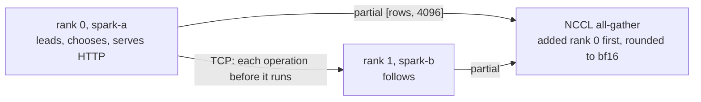

# GLM-5.3-Flash FP4-Local (`nvidia/GLM-5.3-Flash-FP4-Local`, `76348dd`)

**Machines: two DGX Sparks, no fewer.** The language model is 164.87 GiB of weights by the headers (`zspark
info DIR`); a rank of two holds 88.11 GiB of them, 87.81 GiB on its device with the caches of one sequence
(a share loaded in 51 s warm). Each linear runs in its stored format and nothing is requantized (spec 107
WS-02); the whole model on two ranks is held to the card's vLLM below, and timed against it ("Speed"). Every tier
passes on it (`check.sh full` and `ranks glm-fp4-local` at d0586321, 2026-10-21). DFlash2 drafts on it with a four-bit copy of the head read back from its MXFP8 as bf16 rows
("Drafting").

## The checkpoint

| | |
| --- | --- |
| Repository, revision | `nvidia/GLM-5.3-Flash-FP4-Local` at `76348ddb2be2e35e39ecfc00e75dc07703f4f3d5` |
| Base model | `zai-org/GLM-5.3-Flash`; NVIDIA's QAD ("FP4 QAD 1.0"), ModelOpt v0.47.0 |
| Licence | NVIDIA Open Model Agreement (`license: other`) |
| On disk | 177.5 GB: 40 `model-000NN-of-00040.safetensors`, `model-inputscales.safetensors` (36,288 F32 `input_scale`) and `tensors/native-QB.safetensors` (214 BF16), 295,041 tensors |
| Quantization | `quant_method: modelopt`, `quant_algo: MIXED_PRECISION`; a `quantized_layers` map of 494 entries (370 of the language model, 124 of the vision tower) |
| TensorFold family | `glm5_next`; in zspark `zig/src/models/glm5/` |
| Variables | `ZSPARK_GLM_FP4_LOCAL` (`docs/environment.md`) |

The model, from `config.json` (`zspark info DIR`): hidden 4096, vocabulary 154,880, 45 layers (34 KDA, 11 DSA,
every fourth), 4 residual streams with hyper-connections of 24 dots a site, a dense MLP of width 12,288 on
layers 0 to 2 and on layers 3 to 44 a MoE of 288 experts of width 2,048, 8 a token and a shared expert; one
MTP layer (layer 45: DSA and MoE). DSA's indexer keeps the top 2,048 tokens in pools of 4. `--layers L`
(`layers=L`) holds the first L layers with both ranks in one process: a way to try a command on one Spark and
what the tests run, not support for one machine; its replies are not GLM's.

## What is stored

`zspark info DIR` reads it by its headers alone, in 0.4 s and without the GPU; `info DIR all` lists each kind of
tensor (a linear's dtype column says `map`: its parts are counted with it). 294,494 tensors of the language
model; the vision tower's 547 (0.36 GiB) are not read. A linear the map does not name is BF16.

| Storage | Linears | Which | A rank's cut |
| --- | --- | --- | --- |
| NVFP4, group 16, `csf_32x2_v1` block scales | 36,288 | the routed experts of layers 3 to 44 | the packed bytes by rows (gate, up) or by columns (down); the five `weight_scale.csf32_*` streams and `weight_scale_2` whole, each rank decoding its window of the scales |
| NVFP4, group 16, plain F8 scales (`W4A16_NVFP4`) | 864 | the MTP layer's experts | bytes and scales by rows or columns |
| MXFP8, E4M3 with UE8M0 scales per 32 | 157 | KDA's `q/k/v/o_proj` (34 layers), the dense MLPs, the MTP layer's attention (`q_a`, `q_b`, `kv_a`, `kv_b`, `o_proj`, the indexer's `wk`, `wq_b`, `weights_proj`) and shared expert, `lm_head` | by rows, or by columns on whole blocks of 32 |
| `FP8_PB_WO`, E4M3 with F32 scales per 128 x 128 (stored 4-D, read as 2-D) | 170 | MLA's `q_a`, `q_b`, `kv_a_proj_with_mqa`, `o_proj` (11 layers), the shared experts of layers 3 to 44 | on whole blocks of 128 |
| BF16 (not in the map) | 258 | KDA's `f_a`, `f_b`, `g_a`, `g_b`, `b_proj`; MLA's `kv_b_proj` and indexer; the routers; `eh_proj` | as stored |
| BF16 and F32 | | the embedding, norms (`norm` and the sites' `post_attention_layernorm` F32), hyper-connections, conv taps, `A_log`, `dt_bias` | as stored |

The forms are the card's vLLM launch's by a window's rows (spec 115, the owner's option B, 2026-10-19; zspark's
precision is never below the card's in any phase): a window of up to 48 rows (`forward.bf16_rows`: a serial step, a
verify window, a short prompt window) runs bf16 rows, as the card runs the batches its CUDA graphs hold (captured
A16, MTP's mixed graphs up to 24 tokens) and the MXFP8 plans it tunes A16 (its capture sizes, up to 48); a longer
prompt window runs the quantized forms, as the card's prefill. A row's bits are its own within its form, and a
verify window is a serial step's form, so a drafted reply is the serial reply bit for bit. The form is set a window
(`ranks_forward.compute`) and a round's parts (`pool/slots.zig`, the bf16 parts first); the rows a round samples
are headed on bf16 rows. A prompt whose chunks fall on both sides of 48 is not bit for bit the same prompt cut
otherwise. The MTP layer and DFlash2 only draft and keep the quantized forms.

The ranks' partials (the out-projections' and the MLPs' sums, which `hc.post` adds) are bf16 in a window of the
quantized forms, as the card's vLLM and SGLang reduce theirs in every phase: each writer rounds its fp32 sum once,
and the gathers and scatters move half the bytes (spec 116 WS-04, `forward.partials`). A window of bf16 rows keeps
fp32 partials, more than the card's; a round of both forms keeps fp32 and rounds its quantized rows' partials to
bf16 in place, so each row keeps its form's bits. The MTP layer's and DFlash2's partials stay fp32.

KDA's chain takes the same split (spec 116 WS-06, the coordinator's choice): up to 48 rows it chains row by row in
fp32, a step's bits; a longer window runs chunked, FLA's `chunk_kda` as vLLM and SGLang run a prompt
(`kda_chunk.cu`: chunks of 64 rows on the sequence's positions, the WY form's products on bf16 operands with fp32
sums, its triangular solve and every exponent in fp32), within 1e-2 of the fp32 chain on the random layer's outputs
of 2 to 3 (`kda_test`). A prompt's windows before its last end at multiples of 64, so its rows' bits are the same
however it is cut; a mark inside a chunked window moves down to its chunk's start, and the window, asked for it
before it runs, writes the state there as it passes it (a rerun of the chunks to it cost some 29 us a row of a
layer, 0.1 s a rank for a mark 3,600 rows into a window, before the first token). A rank's session no longer saves a
window's KDA rows for a replay past 48 rows: 5.70 GB less at 4,096 rows, the chunked chain's scratch (0.19 GB)
added, 5.5 GB less in all.

The routed experts of layers 3 to 44 (the map's `NVFP4`) in a quantized window run W4A4 as the card's
`prefill_a4` (b12x's `mode="a4"`; spec 114 WS-03, spec 115 WS-03): each pair's row is quantized to NVFP4 under the
layer's gate and up global scale (1 over the largest `input_scale` of the layer's experts, the card's
`a1.amin()`; `model-inputscales.safetensors`), down's under its expert's, in gate and up's epilogue from g and u
rounded to BF16 and clipped, `silu` by the card's `ex2.approx` and `rcp.approx` and the product each rounded to
BF16 (spec 114 WS-07's in-register quantizer), and the products run on the block-scaled FP4 instruction with the
weights' stored codes and scales. In a bf16 window the same experts run A16 (`zs_nvfp4_experts_a16`: the FP4 codes
widened to bf16 in registers, the SwiGLU in fp32 rounded once). Down's per-route sums are stored bf16 before
the fp32 top-k sum, as the card's FC2 (spec 143 WS-08; fp32 before). One departure, above the card: no tiny
weight scale is flushed. The MTP layer's experts
(`W4A16_NVFP4`) keep BF16 activations. A weight is never requantized; an `NVFP4` expert without a finite positive
`input_scale` is refused at load. Against A16 on layer 3's own inputs of 2,048 rows of the score text (spec 114,
per-expert scales): a pair's expert output 13.4% from A16's (relative L2, at most 20%), a row's routed sum 7.9% (at
most 14%); no group's scale saturates.

The MXFP8 linears' activations are quantized as the card's vLLM quantizes them in a quantized window (spec 114
WS-04): 32 inputs under an e8m0 (b12x's `_quantize.py`), and bf16 rows in a bf16 window (the card's MXFP8 at up to
48 tokens may run A16; b12x's MXFP8 has no A16 plan above, `a16_max_tokens` 0). The FP8_PB_WO linears quantize every
row in every phase, as the card: a token's 128 inputs under an fp32 scale (`per_token_group_fp8_quant`). On the
first four layers and the head (`pack_test.zig`, 48 tokens of `primes` in windows of 24 taken as quantized), against
bf16 rows (the experts W4A4 in both): the logits 5.0% off in RMS, the top token kept 46 of 48, KL 4.4e-3 a row, the
next token's loss 0.082 nats off (spec 114's 3.3%, 45, 1.6e-3, 0.045 with per-expert gate and up scales and one
SwiGLU rounding).

`csf_32x2_v1` is not Flash Next FP4-Local's `csf` ([qwen3.8-flash-next-fp4-local.md](qwen3.8-flash-next-fp4-local.md)):
blocks of 32 rows by 2 columns in tiles of 4 by 2 blocks and pages of 32 tiles, a base a row, 4-bit offsets and
U16 exceptions. `weights/csf_blocks.zig` decodes it on the host, held to flashinfer's b12x loader
(`tools/reference/csf_blocks_cases.py`) and, on this checkpoint, to the SHA-256 of six planes that loader
decoded.

## How it runs

| Stored | Kernel (`docs/kernels.md`) | Where |
| --- | --- | --- |
| NVFP4 experts, csf_32x2_v1 or plain scales | layers 3 to 44: `zs_nvfp4_experts_quant` and `zs_nvfp4_experts_a4` in a window of more than 48 rows, `zs_nvfp4_experts_a16` up to 48; the MTP layer's `zs_nvfp4_experts` on BF16 rows (`experts.Experts`), GLM's SwiGLU clip | the scales decoded to E4M3 at load, a rank's window of the plane |
| MXFP8 (K a multiple of 128) | `zs_nvfp4_qmm_a8` mode 2 (`nvfp4.Mx8Linear`), the rows quantized to MXFP8 as vLLM's b12x does (an e8m0 a 32), in a window of more than 48 rows; the lane matmul on bf16 rows up to 48 | KDA's q/k/v/o, the dense MLPs, the MTP layer's attention and shared expert, the head by vocabulary halves |
| FP8_PB_WO 128 x 128 | `zs_nvfp4_qmm_a8` mode 3 (`nvfp4.Fp8BlockLinear`), the rows quantized to FP8 as vLLM's (an fp32 a token's 128, dynamic) | MLA's q_a, kv_a, q_b, o; the shared experts |
| BF16 | `zs_b16_gemm`, as stored | KDA's f/g/b, MLA's `kv_b` and indexer, the routers, `eh_proj` |
| MXFP8 `kv_b` of the MTP layer | widened to bf16 at load, exactly (refused if a value were not) | `dsa.zig` reads `kv_b` as bf16 |
| F32 norms | `zs_glm5_hc_pre`, `zs_rmsnorm` on fp32 weights | `norm`, the sites' `post_attention_layernorm` |

On two ranks a window of 256 rows or more splits its glue by rows (`ranks_forward.zig` `splits`): each rank writes
back and reads out its own rows and receives only those of the other's partials, the same bits. A rank makes the
other's rows of its partial first and sends them on a stream beside while it makes its own.

Departures from vLLM, each lossless: the F32 norms are used as stored, where vLLM's `RMSNorm` holds its weight in
the model's dtype (bf16); the MTP layer drafts with the stored MXFP8 head, DFlash2 with a copy of it ("Drafting").
The caches are FP8, as in the card's command: DSA's latents as the card's record, `--kv-dtype bf16` the option
("Caches (`--kv-dtype`)").

## The two ranks

Every tensor has a split, TensorFold's `split.py:rule` as a table (`layers/layout.zig`'s `kinds`; world 2): half
the rows (`row`), half the inputs (`col`), the vocabulary's half of `lm_head` (`vocab`) or whole (the embedding,
norms, hyper-connections, router, the indexer, `eh_proj`); "What is stored" gives each format's cut.

- What crosses the link is fixed: 90 exchanges of partials a forward (attention and MLP of each layer; fp32
  in a window of bf16 rows, bf16 in a window of the quantized forms, spec 116), and for a row's choice each half's picks, 1 KiB a rank a row. No token crosses as a decision:
  both ranks hold the same gathered picks.
- Rank 1 listens on the link (`--rank 1 --at ADDR:PORT`), rank 0 connects, and the handshake compares the
  build's, the checkpoint's headers' and the options' hashes (`zig/src/ranks/channel.zig`). Rank 0 tells rank 1 each
  operation before it runs it (`lead.zig`); either rank's end ends the other.
- NCCL is linked by `zig build -Dnccl=/usr`. `tools/two_ranks.sh` starts both with the link's two rails and 4
  channels (1.4 times one rail from 64 rows up, spec 045), rank 1 at 198.51.100.2:29551.
- The shared expert and the MTP layer's experts are halved, as TensorFold 0.6.6 has them (1.0.2 holds them
  whole).
- Both ranks in one process (the loopback) is the reference for NCCL's bits.

## Running it

- `zspark serve DIR --rank 1 --at ADDR:PORT` on the second Spark, then the same with `--rank 0` and the
  server's flags on the first. Rank 1 listens at ADDR:PORT on the link, loads its share and follows; rank 0
  loads its own ("Speed" has how), decodes and runs the HTTP
  server. Both take the same `--context` and `--rows`. Ctrl-C on rank 0 ends both.
- One reply at a time unless `--parallel` says. A prompt that begins with the last prompt and its reply runs
  only the rest; any other starts again.
- `--parallel N` on both ranks decodes up to N replies at once, each of `--context` tokens and each the reply
  it gets alone: a round puts every reply's rows through the layers in one window and drafts for all of them
  together, so the ranks exchange as often as for one reply. A slot's memory is counted at the load and an N that does not
  fit is refused there with the most that does.
- A required call and a reply held to a JSON schema are enforced as Flash Next's are.
- `zspark generate DIR [rank=R at=ADDR:PORT] [max=N] ID..` decodes a prompt's ids and times the reply;
  `zspark chat DIR [rank=R at=ADDR:PORT] MESSAGE` answers one message as text. `tools/two_ranks.sh generate
  DIR ID..` (or `chat DIR MESSAGE`, `serve DIR FLAG..`) starts both ranks.
- `--drafter DIR` (`drafter=DIR` for `generate`) drafts with DFlash2 in the MTP layer's place. `--cap N`
  (`cap=N`) cuts the most drafts of a round, the MTP layer's or DFlash2's; `--confidence F` (`confidence=F`)
  sets the product a chain stops under. `drafter_stored` (`generate`) runs the drafter's linears BF16 as the
  file has them, not NVFP4 made at load ("Drafting").

## Reference

The card's: the `eugr/spark-vllm-b12x` container with `--quantization modelopt_mixed`, b12x backends,
`--tensor-parallel-size 2` over two Sparks (`--nnodes 2`), `--kv-cache-dtype fp8`, MTP with 5 drafts. No
TensorFold version reads it (v1.0.12 refuses `MIXED_PRECISION`); SGLang reads `modelopt_mixed` GLM but not
`csf_32x2_v1`.

`tools/reference/vllm_reference_ranks.sh`, a node a Spark, one sequence, no MTP, the experts' activations kept
bf16 (`VLLM_B12X_MOE_FP4_FORCE_A16=1`, `B12X_W4A16_A4_PREFILL=0`), 105's cases and score text tokenized by the
checkpoint's tokenizer. 2026-10-18, image
`eugr/spark-vllm-b12x:03a956544e9f9b4b7ba91690469fbe7848bdbef29a7d2e0f5788368467bb3595` (ID `a7f76ae9f18c`),
one load of 521 s, its rank weights 81.39 GiB; each case and the score twice, the prefix cache reset between.
Kept in `~/.cache/zspark/reference-glm-fp4-local/` on both Sparks (`ZSPARK_REFERENCE_GLM_FP4_LOCAL`). Held to the
zspark load of `778e99a` (`tools/check.sh ranks glm-fp4-local`, `checks/ranks_vllm.zig`):

| | zspark against vLLM | vLLM against itself |
| --- | --- | --- |
| Score, 5,132 tokens: nll | 2.22185 against 2.22567 (-0.0038) | 2.22567 and 2.22472 |
| A token's loss, mean \|difference\| | 0.132 | 0.148 |
| Greedy, primes 32 | every token the same | its two runs the same |
| Greedy, sky 64 and 251 of the 256-token prose | the same to token 30, then a tie: vLLM's first two 13 at -0.577 and 11 at -0.827, zspark took 11; along vLLM's tokens 63 of 64 and 245 of 251 choices the same | the same 64; the 256 part at 251 (0.25 apart) |

The tolerance is vLLM's own spread: zspark's 0.132 a token from vLLM is inside vLLM's 0.148 from itself, and a
reply may part only where vLLM's first two lie within twice that (0.30).

Since spec 114 zspark runs the activations at the image's own precision (W4A4 routed experts, FP8 rows into the
MXFP8 and block-FP8 linears), and is held to the image's defaults instead: `vllm_reference_ranks.sh` with
`PRECISION=image` (no `FORCE_A16`, no `A4_PREFILL`), the same cases and score text, two runs, in
`~/.cache/zspark/reference-glm-fp4-local-w4a4/` on both Sparks (`ZSPARK_REFERENCE_GLM_FP4_LOCAL` names it). Held to
zspark `fcb4e10e`:

| | zspark against vLLM | vLLM against itself |
| --- | --- | --- |
| Score, 5,132 tokens: nll | 2.22273 against 2.22802 and 2.22879 (-0.0057 from their mean) | 2.22802 and 2.22879 |
| A token's loss, mean \|difference\| | 0.2349 and 0.2338 from the runs, 0.2040 from their mean | 0.2334 |
| Greedy | every token the runs agree on: sky and the 256-token prose 15, primes 17 | they part at 15 and 17 |

vLLM's own runs part this early because the quantized activations turn a rounding into a different FP4 code. So
zspark is held as a third run (Fable's rule, `vllm.Sums.exchangeable`): its nll within 0.02 of the runs' mean,
its distance from either run at most theirs from each other and two standard errors (0.243 a token). Its 0.2040
from their mean is what a third run's would be (0.2334 x sqrt(3/4) = 0.2021). zspark's A16 replies are no longer
`serve`'s; against the A16 reference its W4A4 is 0.209 a token.

Spec 115 holds zspark to the card's own launch environment (`PRECISION=card`, `~/.cache/zspark/reference-glm-fp4-local-card`,
spec 115 WS-02; `ZSPARK_REFERENCE_GLM_FP4_LOCAL` names it), its forms by window above, the score text in windows of
512 rows (a prompt's form) with FP8 caches as the card's:

| | zspark against vLLM | vLLM against itself |
| --- | --- | --- |
| Score, 5,132 tokens: nll | 2.22044 against 2.22877 and 2.22805 (-0.0080, a standard error 0.0054) | 2.22877 and 2.22805 |
| A token's loss, mean \|difference\| | 0.2359 and 0.2293 from the runs | 0.1272; vLLM's A16 runs 0.20 from them, its W4A4 0.22 to 0.23 |

The card's runs agree more closely than any other kernel does with them: vLLM's own A16, a precision above the
card's, is 0.20 away. So zspark's distance is bounded by vLLM's across forms, 0.2304 and two standard errors
(`ranks_vllm.zig` `across`; 0.2377 at `8a2e3a56`), and its nll within 0.02. The routes' bf16 store (spec 143 WS-08,
`8a2e3a56`) moved these from nll 2.22472, 0.2258 and 0.2245. Before spec 115 (main `f7157727`, W4A4 in every phase): nll
2.22988, 0.2312 and 0.2259 from the runs.

## Defaults that follow this checkpoint

| | Here | Why |
| --- | --- | --- |
| Ranks | 2; without `--rank` the whole model is refused | 88.11 GiB of weights a rank |
| `--context` | 262,144 tokens | the owner, 2026-10-06, once the indexer and the extent pool allocate the cache; refused at the load where the device cannot hold it |
| Caches (`--kv-dtype`) | FP8: DSA's latents as vLLM's 528-byte record; `--kv-dtype bf16` the option. The indexer's keys and gates bf16, its pooled keys e4m3 with an fp32 scale (132 bytes a pool) as vLLM's, KDA's states fp32, the MTP layer's cache bf16; the FP8 cache attended with FP8 queries and weights as vLLM's (spec 114 WS-05, `ZSPARK_GLM_MLA_Q8`) | The owner, 2026-10-18, as the card's vLLM (`--kv-cache-dtype fp8`): the same score as bf16, 1.33 GiB less a rank at 262,144 tokens, the same prompt rate ("Caches") |
| A prompt's window (`--rows`) | 4,096 rows (the most) | spec 114 WS-08: a 16,000-token cold prompt 9.4 to 10.4 s against 10.65 to 10.8 at 2,048, 4,000 tokens 2.3 to 2.65 against 2.62 to 2.65, the client set and decoding within the spread, 108,296 MiB a rank after the load against 100,955 (109,505 with DFlash2), some 1,028 MiB less since DSA's partials are held for launches under 128 rows alone and a window's running output (spec 116, by the buffers' sizes, not measured); 2,048 was 1.63 to 1.67 times 512's rate |
| `--spill-gib` | off (0), as Flash Next's; `--parallel 1` alone | a state on disk is each rank's half: its KDA states (fp32, the side a window reads and the conv's rows: 70.4 MiB, as a snapshot holds them, spec 112 WS-05), its DSA rows (FP8 records), index keys and gates below it, the MTP cache where that layer drafts; DFlash2's context never (spec 108 WS-04, `docs/serving.md`) |
| MTP drafts | kept while the product of confidences stays at 0.65 on two ranks (0.35 otherwise), 5 at most | `--cap N`, `--confidence F`; spec 114 WS-02: 0.65 is 1.029 times 0.35's replies, a round being bound by the weights' bytes |

## Drafting

| | |
| --- | --- |
| Repository, revision | `incoai/GLM-5.3-Flash-DFlash2` at `bf582e4eacc1810f76656d1811693ff6c6737d2a` |
| Licence | CC BY-NC-ND 4.0: drafting with it is non-commercial use |
| On disk | one `model.safetensors`, 2.34 GB: 81 tensors, all BF16, 2233.7 MiB |
| Variables | `ZSPARK_GLM_DRAFTER`, `ZSPARK_REFERENCE_GLM_DRAFTER`; `--drafter DIR`, `drafter=DIR` |

**Its weights are never committed, vendored, uploaded or redistributed in any form, and no copy of them or of
anything made of them is written to disk.** zspark reads them only from the directory named (`ZSPARK_GLM_DRAFTER`) and downloads
none of it; the four-bit copies below are made in memory at load. The references hold activations, untracked, under `~/.cache/zspark/`.

From its `config.json`: 5 layers of hidden 4096, 32 heads of 128 over 8 KV heads, MLP width 12,288, a block of
8 rows (the pending token and 7 masks), taps after layers 5, 14, 24, 33 and 42 of the main model, a selector
of rank 256 over the top 16. It drafts in the MTP layer's place.

A rank's share after load, in MiB (`zspark info DRAFTER`, `decode/dflash2/layout.zig`):

| Tensors | Split | As stored | TensorFold | zspark |
| --- | --- | --- | --- | --- |
| `fc` [4096, 20480] | whole | 160 | 4-bit, 45 | NVFP4, 45 |
| `q_proj`, `o_proj` (5 layers) | row, col | 80 each | 4-bit, 22.5 | NVFP4, 22.5 |
| `mlp.gate_proj`, `up_proj`, `down_proj` | row, row, col | 240 each | 4-bit, 67.5 | NVFP4, 67.5 |
| `k_proj`, `v_proj` | row | 20 each | 4-bit, 5.6 | **BF16, 20** |
| `attention_conv` and `mlp_conv.kernel_projection` | whole | 40 each | 4-bit, 11.25 | **BF16, 40** |
| norms, base kernels, the selector's projection | whole | 2.4 | BF16 | BF16 |
| the selector's two codebooks [154880, 256] | whole | 75.6 each | fp32 on the host | fp32 on the host |
| A rank's device bytes | | 1162.4 | 328.7 | 414.9 |

- Requantized at load, by default: `fc`, `q_proj`, `o_proj` and the MLP's three, to NVFP4 where TensorFold
  makes affine 4-bit copies. Kept BF16 where TensorFold holds four bits: `k_proj`, `v_proj` (a context row's
  stay in the cache for the window) and the kernel projections. **That is zspark's choice** (the owner, spec
  067, 2026-10-06 and 2026-10-09: "not turned to NVFP4 whole").
- No option of `serve` runs the drafter as stored: `generate`'s `drafter_stored` is the one word that does.
- The context's K and V are bf16, a ring of 2,176 rows: 21.3 MiB a rank.

Without `--drafter` the MTP layer drafts, with its stored MXFP8 head. `--drafter DIR` on both ranks loads
`incoai/GLM-5.3-Flash-DFlash2` (read where it is, nothing of it written; under `--weights-from-peer` from rank 0's
Spark alone, sent to rank 1 over the link, "Speed") and drafts with it instead (spec 107
WS-04): it scores drafts with a four-bit copy of the head, made at load of the MXFP8 head read back from the device
as bf16 rows (`nvfp4.Mx8Linear.bf16Rows`, exact), and re-scores its picks against those rows, held on the device
(0.59 GiB a rank). Only what drafts is quantized; a reply's tokens are the model's either way.

With several streams, `pool/hall.zig` recomputes each live stream's draft allowance every round from the
hall's depth and that stream's remaining output tokens. A short or empty draft result sets the pending
verify window only; it does not reduce the next round's allowance. Every drafted stream contributes a job
to the shared drafter pass, including a stream whose previous pass returned no drafts.

TensorFold 1.2.7's [shared-round fix #2793](https://github.com/ashhart/TensorFold/pull/2793) removes a
DFlash2 pre-draft allocation policy that could leave a stream at zero allowance while peers decoded.
zspark's hall has no such allocator or carried grant.

Measured 2026-10-20, zspark `131fd5a3` (`0.0.0+fast`) on both Sparks held alone, `glm5_client_bench.sh` on the
whole set, `CONTEXT=262144`, one load each (`scratch-116/close-fast`); every reply's text the same in both loads:

| | MTP | DFlash2 | DFlash2 is |
| --- | --- | --- | --- |
| Every reply, `warm` apart | 43.1 tok/s | 48.2 | 1.12x |
| code-long / prose-long, 512 tokens | 47.1 / 33.8 | 58.7 / 34.1 | 1.25x / 1.01x |
| thinking / code-short | 53.7 / 55.8 | 63.4 / 78.0 | 1.18x / 1.40x |
| First token cold, 3,694 / 14,964 tokens | 1.94 / 7.61 s | 2.10 / 8.24 | 0.92x / 0.92x |
| Device memory a rank after the load / after the requests | 101,885 / 102,944 MiB | 103,094 / 104,293 | |

At `fa6cb10` (2026-10-19) every reply was 38.1 to 39.3 tok/s by MTP and 44.9 to 45.2 by DFlash2, the cold
first tokens 3.05 / 12.70 s and 3.52 / 13.65.
The drafter's own pass over a cold prompt costs its first token some 8%; on a held turn it is within the spread.
`ranks-check reference=REF drafter=DIR`: the vLLM cases' greedy and sampled replies drafted by DFlash2 the serial
ones, 41 of 65 and 159 of 250 drafts kept on `sky` and `sky-long` (the MTP layer 40 of 69, 156 of 263).

## Caches (`--kv-dtype`)

Spec 107 WS-03, zspark `9862d28` on both Sparks, a rank a Spark. vLLM's `fp8_ds_mla` record (read in its source:
the group's amax / 448 a scale, applied after the products): `mla_write` codes a row in the forward that attends
it and every row reads codes, its own window's too, so a window's rows are its serial steps (`dsa_test.zig`'s FP8
cache; `ranks-check DIR reference=REF kv=fp8`: a prompt's window its serial steps, every drafted reply the serial
one). Against bf16:

| | FP8 | bf16 |
| --- | --- | --- |
| Score text, 5,132 tokens: nll (vLLM's runs 2.22567, 2.22472) | 2.21824 | 2.22185 |
| A token's loss from vLLM's, mean \|difference\| | 0.1385 | 0.132 |
| Greedy against vLLM | primes and sky every token; the 256-token prose to token 119 | to token 30 (a tie) |
| A layer's output on the fixture, of its largest (`dsa_test.zig`) | 0.028 from bf16's | |
| Device memory after the load, 262,144 tokens, a rank | 95,253 MiB (share 92.69 GiB) | 96,617 MiB (94.02 GiB) |
| Cold prompt, 14,964 / 57,893 tokens | 634 / 619 tok/s | 639 / 625 tok/s |
| 320-token replies held at 15k and 58k tokens, ms a round | 91 and 94 / 87 and 94 (101, 86, 110, 97 rounds) | 83 and 89 / 89 and 89 (101, 87, 99, 97 rounds) |
| `attend` alone past the dense limit (`profile_test.zig`), 1 / 8 rows / a 512-row window | 80.5 / 93.3 us / 4.74 ms (FP8 queries since spec 114 WS-05: 60.6 / 73.0 us / 3.12 ms; the window form since spec 116 WS-01: 512 rows 1.67 ms, a 4,096-row window 24.9 to 12.7) | 72.9 / 95.6 us / 4.36 ms |

Loads of `glm5_client_bench.sh` at 512-row windows, one each, on a set of 16,000- and 64,000-token prompts; the
replies' drafts differ, and a round is within them. The record is 528 bytes of a token's 1,073 a DSA layer (bf16
1,569; 1,104 and 1,600 before the pooled keys were FP8), so the saving is 496 bytes a token a layer. A bf16 reply is not an FP8 one's.

Since spec 114 WS-05 the FP8 cache is attended at the card's vLLM's precision in every phase (b12x requires its
FP8 compute mode for this record, `traits.py` 311-314, in decode and extend alike): the queries e4m3 per (head,
128) on a power-of-two scale, the scores by the block-scaled e4m3 mma times the key's group scales, P.V by HIGH
and LOW e4m3 weights on a (head, group, 32-key tile) scale (`mla_q8.cu`; vLLM's tile is 64 keys, so near and not
its bits; `ZSPARK_GLM_MLA_Q8=0` keeps bf16 queries). Alone past the dense limit, off, on, on, off (machine alone,
`scratch-114/ws05`): 1 / 4 / 8 rows 80.3 / 88.3 / 93.2 us to 60.6 / 67.5 / 73.0, a 512-row window 4.75 ms to
3.12, under bf16's cache too. On `dsa_test.zig`'s fixture a layer's output 0.029 of its largest from bf16
queries', 0.049 from the bf16 cache's; on rows made by hand 0.0022 of a head's largest mass from the host on the
same FP8 queries.

Since spec 116 WS-05 the indexer is the card's vLLM's (`nvidia/pooled_indexer.py`, `ops/glm_kpool.py`, b12x's
`dsa_indexer`; SGLang's `kpool_fp8_index.py` alike) in every phase, where TensorFold's is bf16: the pool an fp32
softmax sum rounded once to bf16; a pooled key and each head's query rotated by the 128-point Walsh-Hadamard
transform, rounded to bf16 and stored e4m3 under one power-of-two (ue8m0) scale, the key's beside its 128 codes
(132 bytes a pool, 33 a token where the bf16 pooled key was 64), the query's folded into its head weight with
1 / 64; the head weights an fp32 product, as vLLM's; the score relu(q8 . k8) times the weight summed over heads,
times the key's scale, on the FP8 tensor cores (`mma` m16n8k32 e4m3, fp32 sums). Where vLLM's Triton is
approximate (`tl.exp`, `tl.log2`, the division) `index.cu` takes the exact operation. The pooled keys are 0.09
GiB less a rank at 262,144 tokens (12 caches x 31 bytes a token). Alone on spark-b, machine held: the score over
a 4,096-row window at 12,288 of a 16,384-token prompt 8.66 to 8.93 ms bf16, 1.97 to 1.99 ms coded and scored;
4 decoding rows at a 65,536 bucket 34.7 us to 13.8.

## Speed

Spec 116's close, 2026-10-20: zspark `131fd5a3` (`0.0.0+fast`, the default build) at these defaults (MTP drafting as `serve` does,
`glm5_client_bench.sh`, the whole set of 105's `tools/reference/client_bench.json`, seed 1, `CONTEXT=262144`, both
Sparks held alone, one load, medians of two repeats), against the card's vLLM as spec 107 WS-03 measured it on
2026-10-18 (`vllm_reference_ranks.sh bench`, image `a7f76ae9f18c`, TP 2 across both Sparks, MTP of 5,
`--max-num-seqs 4`, FP8 caches; the card's environment, so its prompt experts W4A4 with one scale a layer
(`B12X_W4A16_A4_PREFILL=1`) and its decoding experts on bf16 rows: spec 114 WS-06 read it in the image's source).

| What a client sees | zspark | the card's vLLM | zspark is |
| --- | --- | --- | --- |
| Ready, the process's start to `/v1/models` | 11.6 s | 677 s | 58x |
| Device memory a rank after the load / after the requests | 101,885 / 102,944 MiB | 104,556 / 105,858 MiB | |
| First token, a 58-token prompt cold | 0.309 s | 0.419 s | 1.36x |
| Prompt tok/s cold: 483 / 3,694 / 14,964 tokens | 709 / 1,906 / 1,966 | 645 / 1,652 / 1,915 | 1.10x / 1.15x / 1.03x |
| A held turn's first token (second, edited and later turns on 500 to 15,000 held) | 0.12 to 0.23 s | 0.62 to 0.69 s | 2.7x to 6x |
| prose-long / code-long, 512 tokens | 33.8 / 47.1 tok/s | 27.7 / 31.3 | 1.22x / 1.50x |
| prose-short / code-short | 40.4 / 55.8 | 34.0 / 39.5 | 1.19x / 1.41x |
| prose-long / code-long sampled | 33.9 / 44.7 | 29.4 / 31.4 | 1.15x / 1.42x |
| Every streamed reply, `warm`, `thinking` and `tool-call` apart | 42.3 tok/s (10,613 tokens, both repeats) | 33.9 (5,157) | 1.25x |

Not comparable: `thinking` (vLLM's reasoning parser streams the thought as `reasoning_content`, its first text
delta after it) and `tool-call` (23 tokens against vLLM's 60, a whole request's rate). vLLM reports no held
tokens (`cached_tokens` 0) though its prefix cache serves the turns. Ready was 39.5 s at `7860efd`. A rank's load
went from 37 to 47 s on 2026-10-19 by the build, not the machines: `tools/check.sh ranks` rebuilt `zig-out/bin`
in the default ReleaseSafe over a `-Doptimize=fast` binary of the same commit, and the version string does not
tell them apart (47.5 s safe, 37.0 fast at `e61646d2`). The load is now a pipeline (2026-10-20, branch
`load-time`): a reader thread reads the next part while the loading thread packs this one, the experts' cuts and
csf scales on 16 threads; a rank's share in 15.0 s fast and 16.0 safe, ready 18.5 and 19.9 s, the reads 10.7 s of
113.6 GiB at the disk's 10.6 GiB/s. Then (branch `load-time2`, one load each, fast, replies' sha the same): parts read
into two kept buffers, 12.75 s, ready 16.1; the routed experts' csf scales decoded and packed by the device from
those buffers (`experts.Experts.initPlaced`), 11.3, ready 14.6; the first parts read during the join, 11.0, ready
14.3; each rank reading half of every routed down projection and trading the rest over NCCL (`experts.Swap`), the
draft heads' rows widened on threads: a share in 9.4 s, ready 11.6, the reads 8.5 s of 90.0 GiB, which bound it.

With the checkpoint on rank 0's Spark alone (`serve --weights-from-peer` on both ranks, `docs/serving.md`, branch
`weights-from-peer`, one load, fast, rank 1 given a directory that does not exist, replies' sha the same): rank 0
reads rank 1's ranges of each part first into a pinned buffer of their own (`pack.Slot.peer`), sends them over a
communicator split from the ranks' (`pack.Line`, NCCL on its own stream, two sends in flight) and reads its
own ranges not already among them while they travel; rank 1 reads nothing and receives into its stage. A share in
18.4 s and ready 21.5 against 9.4 and 11.6: rank 0's reads, 165.2 GiB in 15.7 s at the disk's 10.5 GiB/s, bound
it, the link's some 90 GiB at about 22 GiB/s (4 s) under them. The down projections' halves are still swapped.
With DFlash2 too (`--drafter` on both ranks, rank 1 given a drafter directory that does not exist, branch
`drafter-from-peer`, `0659b403`, fast, `ONLY=prompt-500-cold`, one load each): rank 0 reads the drafter's file whole
into a page-locked stage (0.24 s of 2.18 GiB, direct reads) and sends it over the ranks' communicator; rank 1
receives it into its own and both load their shares from there (`rig.Source`). A share in 17.5 s and ready 27.4,
against 9.3 and 14.1 for the default `--drafter` load, each rank its own copy of both; both replies' sha the same.
Without the drafter the mode was ready in 21.5 (above), so the drafter adds some 6 s here against 2.5 in the
default, more than the crossing's own 0.5 s (a stage made and read, timed alone) and some 0.1 by the link's rate.
Traced with `ZSPARK_LOAD_PHASES=1` (2026-10-21, branch `glm-load`, `~/.cache/zspark/scratch-glmload/`, the page cache
evicted before each load: a download's 57 GiB of it on the same disk made one 41.6 s): the stage was made and read
after the caches and the draft heads, 5.5 s on rank 0 for its 2.18 GiB of page-locked pages with some 95 GiB taken,
and the default mode's drafter read through the mapping, 1.7 to 2.3 s. The stage is now laid and read on a thread from
the session's start, before the shares (0.3 s, under the join), and the drafter's share loaded and its stage freed
before the caches and the heads, which held beside it took 2.9 s; the reader finds each part's tensors once (its
ranges 0.53 to 0.06 s). Under `--weights-from-peer` with the drafter a share in 17.1 s and ready 20.9 (from 17.5 and
27.4), the reader 167.4 GiB in 16.1 s, the tail after the shares 1.9 s; the default `--drafter` load ready 14.2, as
before (the shares 9.1 s, rank 1's draft heads 2.8 s against rank 0's 0.45, its page cache at 10 GiB). Withdrawn as
gaining nothing: the four-bit head made on the loading thread after the top part (it stalled the reader a part ahead,
the share 21.7 s), rank 0's own ranges read beside rank 1's (16.6 s of reads against 16.9), and one `cudaMalloc` a
layer (its cost is bytes, not calls: `cuda-gb10`'s `references/loading.md`). The same loads found the mode hanging at layer 4 at `87479d00`, with the drafter or without: rank 1's
loader waited for the device, its next part's receive among it (`experts.Staging.settle`, now its stream alone).
2026-10-21, branch `load3`, `ONLY=prompt-500-cold` seed 1, one load each, both shas unchanged: the default
`--drafter` load's draft heads took 2.7 to 2.8 s on both ranks at `3a1653ab` (ready 14.5), nearly all of it the
copy of a head's bf16 rows from the device into freshly allocated host pages (about 0.13 GB/s now and then, against
54 GB/s into touched ones: `cuda-gb10`'s `references/loading.md`). The pages touched first (`Mx8Linear.bf16Rows`,
`rig.draftHeads`): the heads 0.43 s on each rank, ready 11.8.

How the cold prompt got there, first token at 14,964 tokens: 14.75 s at `15ebf4b` (2,048-row windows, FP8
caches); 12.71 s at `7860efd` (spec 107 WS-03: the hc mix's window kernel, the experts' scale folded into their
weights, the glue split by rows over the ranks); 10.83 s at `0fed04ae` (spec 114: the linears' and the routed
experts' rows quantized as vLLM's, on FP8 and FP4 tensor cores, DSA's queries FP8, down's rows in gate and up's
epilogue); 7.6 s at `17d81f42` (spec 116: DSA's window form, the indexer FP8 as vLLM's, KDA chunked on a
prompt's windows, the scatters beside the window's own rows, a quantized window's partials bf16). Decoding moved
with them: every reply 36.4 tok/s at `7860efd`, 43.0 to 43.35 at `0fed04ae`, 43.1 now (`warm` apart, the
`Drafting` table's measure).

### Chooser, mixed projections and TP2 graphs

Spec 166, 2026-11-11, clean diagnostic `5a1d55f0`, fast build, two exclusive GB10s, CUDA 13.0.88,
driver 580.178.04. One TP2 load uses MTP, FP8 KV, context 32768 and four slots. Greedy Structured
and Prose requests target 128 output tokens at one/four streams; prime/before/trace/after waves
separate warmup and node tracing. Cold 4k/16k prompts use fresh prefixes: the traced requests have
4129/16421 actual prompt tokens, zero cached tokens and early EOS after two output tokens. Their
2.81/10.77 s first-token times describe prefill; they do not measure sustained decode.

For the single-stream Structured trace, the chooser makes 25 `accept` calls for 128 output tokens.
There are 128 `logitsRow` reads including the prompt's first choice, 128 explicit synchronizations
(1559.3 ms) and 256 half-row downloads (39,649,280 bytes in 4.4 ms, about 9 GB/s). Four-stream
Structured reads 512 rows and 158,597,120 bytes in 15.3 ms. The `accept` timer includes its nested
GPU waits; the prompt's first `logitsRow` is outside it. Subtracting all synchronizations from
`accept` would give a negative residual, not zero sampler CPU. Separating the prompt's first
147.2 ms synchronization leaves about 1416 ms of decode reads inside 1417.9 ms of `accept`.
Sampler CPU is not separately published by `serve`; the single-stream trace's 45.5 ms union of
inter-API gaps is a broader bound, about 1.9% of request wall time. Synchronization waits are
dependencies on GPU work, not a removable CPU cost.

Rank-0 trace durations, milliseconds; the span runs from first to last kernel. NCCL intervals
include waiting for the peer. Placement columns are kernel sums, NCCL columns are interval unions.

| Case | Kernel span | AllGather union | Overlap with compute | Placement |
| --- | ---: | ---: | ---: | ---: |
| Structured, 1 stream | 2429.6 | 229.1 | 0 | 4.1 |
| Prose, 1 stream | 3442.9 | 254.9 | 0 | 7.3 |
| Structured, 4 streams | 3900.2 | 259.4 | 0 | 6.9 |
| Prose, 4 streams | 5754.2 | 347.2 | 0 | 10.3 |
| Cold 4k | 2856.3 | 276.5 | 118.4 | 31.8 |
| Cold 16k | 10808.9 | 1062.4 | 457.9 | 128.0 |

The staged projection class is KDA `proj` (the stacked Q/K/V and gate parts): `n=12576`,
`k=4096`, two runs, MXFP8 at column 0 and BF16 at 12288. This checkpoint has 34 KDA layers and
11 DSA layers. The 34 logical KDA projections borrow the same staging buffer for a matching scratch
shape; census pointers identify shared-buffer classes, not unique layers. The census observes direct
aligned writes at one row and staging at multiple rows, up to 960 rows in these prompt chunks.
These format names describe stored weights; existing activation-form rules still apply. Class-level
placement is below 2% of the kernel span and occurs throughout forward order, including decode.
The traces do not assign a separate cost to each aliased layer. Flash Next's decode has no such staging.

Both GLM ranks run eagerly in this configuration: no graph launches or replayed nodes. The pool
deliberately disables graphs for paired ranks (`session/session.zig`); the follower handles
`slots_forward` eagerly and has no pool capture operation. Enabling graphs requires a matching
follower capture/replay protocol. Host launch API totals overlap GPU execution: for example,
single-stream Structured has only 110.8 ms outside the kernel union, including copies and other
work. Its launch API time is not a 19% speedup opportunity. Layer gathers feed the next layer;
the logits gather feeds sequential acceptance. No safe overlap or graph toggle is established by
these traces. Keep the current chooser, staging and graph gate; no implementation candidate or
additional acceptance loads were selected.

Reproduction uses `scratch-166/launch.sh glm` and `node scratch-166/run_cases.mjs glm` under
`~/.cache/zspark/`, with both-rank traces, corrected analysis scripts and `local-summary.json` /
`peer-summary.json` beside them. The diagnostic source is preserved in `5a1d55f0` and
`diagnostic-final.patch`; temporary probes are removed from production source. These are one-load
attribution figures, not a base/candidate speed comparison.

## Tests

With `ZSPARK_GLM_FP4_LOCAL` set, `tools/check.sh host` runs, without the GPU:

- `tests/models/glm5/layers/layout_test.zig`: every tensor in GLM's layout by the map, every entry met, the
  counts and bytes above;
- `tests/models/glm5/layers/share_test.zig`: a linear of each storage cut for both ranks, the halves against
  the whole as stored;
- `tests/weights/csf_blocks_test.zig`: six planes against flashinfer's hashes, the rank windows, layer 3's 864
  planes validated.

Unset, they skip; the synthetic forms (`modelopt_fixture.zig`) run always. On the GPU:

- `tests/models/glm5/session/pack_test.zig` (`check.sh glm5 "FP4-Local"`): both ranks' first four layers and the
  MTP layer in loopback, 12 GiB: windows of 16, 8 and 5 their serial steps, greedy and sampled replies drafted
  by the MTP layer the serial ones.
- `tools/check.sh ranks glm-fp4-local`, with `ZSPARK_REFERENCE_GLM_FP4_LOCAL`: the whole model, a rank a Spark,
  against vLLM as above; a prompt's window its serial steps and drafted replies the serial ones, in bits; 5 minutes
  on a warm page cache. `zspark ranks-check DIR reference=REF layers=4` in one process prints the digest
  `two_ranks.sh ranks-check DIR reference=REF layers=4` prints on both ranks (3eb5f84f9b94c921 at `778e99a`):
  every bit over NCCL the loopback's.
