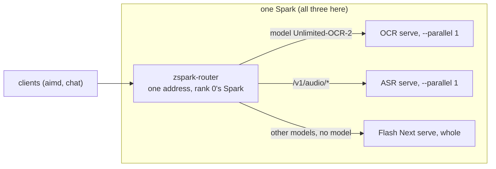
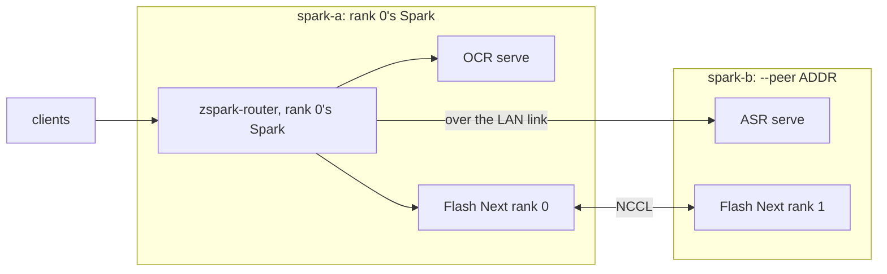

# Running Flash Next: one reply, drafting, the server

What `chat` and `serve` do and take, for a client and for whoever starts them. What a checkpoint decides
(storage, defaults that follow it, every figure) is on its page under [`recipes/`](recipes/README.md);
`README.md` has the build and the checkpoints. GLM-5.3-Flash's commands are on
its FP4-Local page ([glm-5.3-flash-fp4-local.md](recipes/glm-5.3-flash-fp4-local.md)); the server's routes and a reply's constraints below are its too.

Everything here is Flash Next's, on any of its checkpoints: DIR is a checkpoint's
directory, for every command (`chat`, `serve`, `generate`, `score`, `compare`, `trace`, `info`) and with every
`--kv-dtype`.

## One reply

```bash
./zig-out/bin/zspark chat DIR --no-thinking "List the first five prime numbers, separated by commas."
```

The reply streams to stdout; the reasoning and the timings go to stderr. `zspark chat` alone lists the options
(system message, a messages or tools file, sampling, `--render` to see the prompt without loading the model).
`--schema FILE` holds the reply to a JSON Schema and `--json` to a JSON object: every token is chosen among
those the document may go on with, drafted or serial, after the reasoning when thinking is on. A schema with a
keyword that is not read (`pattern`, `allOf`, `minimum`, ...) is refused by that keyword's name before the model
loads; `zig/src/text/json_schema.zig` says what is read.

A reply's steps replay captured CUDA graphs; `--eager` launches each kernel from the host instead, with the same bits.
The graphs are captured while the model loads (80 at the default depth for `chat` and for `--parallel 1`:
about 0.2 s of the load and 100 MiB on the device), so no step of a first reply waits on a
capture. They cover sequences of up to 8192 tokens; a longer
one captures its graphs as it goes, and `--lazy-graphs` leaves them all to the step that first needs one.
`serve` with `--parallel` above 1 captures the same graphs as `--parallel 1` while it loads, and one live
stream replays them: contiguous caches, today's kernels, the head's graphs included. A second stream frees
that cache and opens the shared pool. A round of several streams uses the shared graphs, 31 of them for reply
windows under 32 rows, captured as that pool opens. A wider round, and a prompt's chunk, launch directly.

## Drafting

The checkpoint's MTP head drafts up to fifteen tokens a step and the model verifies them in one window,
keeping those it would have chosen itself: the reply is the one serial decoding gives, token for token, greedy
or sampled, and faster (figures: each checkpoint's page, "One `generate` load", serial against drafted). A reply that is offered tools and may call one
or not opens with a window of six drafts at most, so that the call's first delta does not wait for sixteen rows. The head drafts on
while a draft pays, as TensorFold 1.0.2 does: while the square of what it gives its chain covers what the
stream's recent rounds earned for the cost of one more row. What the head gives a chain is held to how
often the stream's drafts were kept, the head being surer on prose than it is right (spec 061; what it
gained over the floor it replaces is on each page). The costs are constants a storage, not timed at load.
`--serial` decodes without drafts, `--depth N` sets the most drafts a step, for `chat` and for `serve`.
`serve --drafter DIR` drafts with DFlash2 (`Qwen3.8-Flash-Next-DFlash2`, as `generate DIR N drafter=DIR`
does) in the MTP head's place for the whole load, a block's seven drafts a window at most; without it the head
drafts, the default, and `--serial` drafts with neither (spec 126, the owner's word of 2026-10-25). Several
replies at once draft by it too: the pool's rounds write its taps of every row, each stream holds its own seat of
the drafter's context, and one pass drafts the blocks of a round's streams side by side. The reply is the serial
one either way. The pool offers no copies of the context beside DFlash2. On two ranks (`--rank`) each rank
loads its own share of DIR at the load and holds a drafter context a stream; rank 0 alone schedules and
proposes for the shared pool and rank 1 replays the passes it is told, so the replies are the two ranks'
serial ones token for token at any `--parallel`. Its passes are eager there, as in the pool on
one rank. A stream alone on two ranks without the pool still answers through `ranks_drafter.Given(1)`.
On two ranks (`--rank`) Flash Next drafts the same way: each rank holds half of the MTP head as it holds half
of a layer, both compute a drafted level and rank 0 chooses the drafts for the window both ranks verify, so
the reply is the two ranks' serial one token for token. Both ranks are started with the same drafting flags
(`tools/two_ranks.sh` does). `ZSPARK_RANKS_HEAD=whole` keeps the head whole on rank 0, a few percent slower. `ZSPARK_DRAFTS_STORED` is refused there.
While three or more streams decode at once on two ranks, each drafts at most four tokens a round (spec 144
WS-04): the round waits for its deepest stream's chain, a level at a time; the replies are the same.
Two ranks keep the sequence they ran as a session does (spec 094; "A conversation's states" below): the states
stand at the same positions, rank 0 telling rank 1 each one taken and dropped, and `cached_tokens` counts as
on one rank. A turn's new tokens run in one window, as on one rank, and a prompt in windows of 4,096
rows unset (spec 149 WS-04; 2,048 before), or `--max-num-batched-tokens` (spec 111; one rank's lone stream takes 4,096 unset since spec 148; 512 before: a 16,000-token cold prompt on FP4-Local
1810 to 2780 tok/s with spec 111 WS-02's, 3.6 GiB more a rank; the figures in its recipe). They keep no conversation
they left and no state on disk.

Where a reply repeats what its prompt or the reply itself already holds (a file edited, a call that echoes its
argument), the drafts are instead what followed the earlier occurrence, as TensorFold 1.0.2 copies them
(its `SuffixLookup`, a match of six tokens at least), but only where the copy begins with the head's own first
draft, and never in a reply held to a schema or a required call. A reply that repeats nothing is drafted as
before (spec 060; the pages have an edited file's, a rename's and an echoing call's rates under "Drafting").
`--no-copies` drafts with the head alone.

`--recall` (off by default; TensorFold 1.0.12's Recall, spec 106) keeps a record of the ids every request read
and wrote, and a window whose context holds nothing to copy asks it: a request sent again, an agent's call run
again, a file written out a second time is drafted from what an earlier request's reply held. A copy goes in only
where its expected tokens, at the landing rate its match length has shown, beat the reply's own rounds, and as a
context's copy, where it begins with the head's first draft; the reply's tokens are those without it. The record
is chunk files under `~/.cache/zspark/recall/TOKENIZER/` (`--recall-dir` says where), `--recall-gib` (1/16) of
disk and about twice that of host memory once full, the oldest chunk going first, and stays across restarts;
`--recall-read-only` reads it and adds nothing; `GET /v1/recall` reports it and `DELETE /v1/recall` empties it.
A second server on the same directory reads it and writes nothing. Refused with `--no-copies`, a serial reply,
two ranks, and on GLM.

`--warm-turns` (off by default; TensorFold 1.0.12's `warm_turns`, spec 106) has the host send, after each chat
reply, the conversation again with the reply as its client got it (its content, no reasoning) and the next
user turn's header, as a request of no tokens. The pool runs it as a reply of one token sent nobody, and the
next turn goes on from the state two tokens before its end: it runs its new message, where without the pass it
would run the reply again, which the template renders without its reasoning. The pass first waits 150 ms
(TensorFold's `warm_quiet`) and is dropped if a request comes in that time. It never stands beside a
live stream: it is dropped while another request is in the pool, ended unrun when one comes while it waits for
its round, and a request that comes while it runs is taken in the next round (in the pool after its current
chunk; as the lone stream after its prompt, which is then at most one prompt window). Its one token's end state
is not kept. Under `--parallel 1` it runs none (said in the log); refused with two ranks, and on GLM.

## The server

```bash
./zig-out/bin/zspark serve DIR --port 8000 --name qwen3.8-flash-next
curl localhost:8000/v1/chat/completions -H 'content-type: application/json' \
  -d '{"messages":[{"role":"user","content":"Why is the sky blue?"}],"stream":true}'
```

`zspark serve` keeps the checkpoint loaded behind TensorFold 1.3.4's HTTP host. OpenAI chat and completion requests serve one choice. The cache-salt request field and `--cache-salt-per-key` are unavailable because the engine does not partition saved prompt states by salt. Its
request parsing, its chat template and tokenizer and its reading of a reply are TensorFold's, compiled from
`zig/vendor/tensorfold/`, and the decoding under them is zspark's (`zig/src/server/served.zig` over `zig/src/models/qwen4/served.zig`). So a client is answered as
TensorFold answers it: OpenAI chat completions (`POST /v1/chat/completions`), streamed or whole, with
`reasoning_content` (since 1.2.1 the streamed `delta.reasoning_content` joined equals the finished field, trailing think whitespace held back), tool calls read out of the reply as it is written (a call's name, then its arguments in
deltas), `stop` strings, usage, and the sampling fields (`temperature`, `top_p`, `top_k`, `min_p`, `seed`; a request's `presence_penalty`/`frequency_penalty` are ignored and the host says so once);
what a request leaves out comes from the checkpoint's `generation_config.json`; a seed left out is drawn fresh,
as TensorFold 1.1.1's, vLLM's and SGLang's, or keyed to the prompt under `--prompt-seed`, spec 113), and
`skip_special_tokens` (true where left out, vLLM's default: the tokenizer's special tokens leave the reply's text;
thinking and call markers are not special tokens; spec 137 WS-10). `--instruct-sampling card` (or
`field=value` pairs) serves the card's instruct sampling to a sampled chat request with thinking off that
leaves the fields unset (TensorFold 1.2.7): a request's fields win, then the serve flags, then the pairs; the
server's own requests never take it, and a model whose sampling table has no instruct entry keeps its defaults.
On a greedy-only engine a `--instruct-sampling` other than `none` is refused at startup; a sample-capable
engine whose `generation_config` sets `do_sample: false` logs upstream's not-served note. Whole replies
keep the prose written before a tool call in `message.content` (`null` only for a reply
of calls alone), and a reply's `tensorfold` fields carry `token_sha256`, the whole SHA-256 of its token ids,
beside `token_sha`, and with `return_token_ids: true` the ids themselves as `token_ids` (TensorFold 1.1.5; on
the whole reply and the stream's last event). On GLM, `chat_template_kwargs.clear_thinking` (true or false;
another value is a 400) is the template's for that request, and `TF_GLM_CLEAR_THINKING=1` the server's
(TensorFold 1.1.5; left out, the FP4-Local template keeps earlier turns' reasoning, as before). Beside it: legacy `POST /v1/completions`, `GET /v1/models` (each model with the server's
context as `context_length` and `max_model_len`, and a `reasoning` object: `default_enabled`, `supported_efforts`
as the template names them), `GET /health` (without keys also the `version`, `backend` and `device`), `GET /metrics`, `GET /memory` (the context and the
device's bytes), `GET /v1/load` (TensorFold 1.2.1: the load ledger; zspark's engine group is absent), `POST /tokenize` and `/detokenize`, and with `--dashboard` `GET /dashboard` and `/stats`.
TensorFold 1.3.2 adds `GET /v1/models/{id}` on `serve` and reports supported input modalities in model entries.
For an ordinary chat reply that reaches EOS inside an unclosed thinking block, the host can return that text as content.
TensorFold 1.2.8 adds `POST /v1/requests/{id}/cancel` for a running or queued `chatcmpl-`, `cmpl-` or `resp_` request:
it uses the engine's disconnect cancellation path, ends the reply as `cancelled`, and keeps tokens already produced.
With API keys it requires a full or admin key; without keys it accepts only direct loopback callers and refuses
proxied cancellation with HTTP 403 `loopback_only`. Connection admission defaults to 128 slots; at 96 open slots,
one address is limited to a quarter of them. `--max-connections`, `--max-connections-per-address` and repeatable
`--trusted-proxy` control that policy. Bodies on routes that do not read them are capped at 64 KiB (HTTP 400 above it).
Template rendering and tokenizer patterns now have counted work limits, tokenizer ids are capped at 2^24, and
xgrammar exploration is capped at 2^38 parser steps; an over-budget grammar is refused with HTTP 400.
TensorFold's Sliding Weights routes exist and learn nothing here: `POST /v1/slide/learn` is a 501. It listens on
127.0.0.1:8888 unless `--host` and `--port` say otherwise (TensorFold's 8080, vLLM's 8000: the owner's, spec
101), or on `--unix-socket PATH` alone (TensorFold 1.2.7, not with `--host`/`--port`); `--api-key`, `--api-key-file` or `TENSORFOLD_API_KEY` asks for a key on every route but a `GET` of
`/health` and the Sliding Weights page's files (TensorFold 1.1.1). Bound to a loopback address, it answers only a
`Host` that names one or an `--allowed-host`; a browser's `Origin` of another site only when `--allowed-origin`
names it: else a 403 that closes the connection (1.1.1's guard). A reply that names no `max_tokens`
(or 0) may take what the context leaves, as vLLM's and SGLang's do; `--max-tokens N` makes N the default, cut
to the room (TensorFold's is 4096). `usage.completion_tokens` counts the token that ends a
reply, one more than zspark's own server counted on a reply that stopped. Flags of TensorFold's that zspark's
engine does not read are said so in the log and change nothing (`--speed-up`,
`--backend`, `--device`, `--segments`); `--slide`, `--slide-graph`, `--drafter-bits`, `--chat-template`,
`--warm-turns` and `--recall` with its `--recall-*` on GLM are refused, as are 1.0.12's `--learn-conversations`, `--learn-daily-gib`, `--record`,
`--precision`, `--cortheon`, 1.1.1's `--kv-cache` but `bf16`, 1.1.5's `--loops`, 1.2.1's `--name-priority`, `--loop-guard-stop`, `--rope-yarn` and `--decode-share`, 1.2.7's `--idle-unload`, `--record`, `--max-frames`, `--learn-daily-gib`, `--learn-min-free-gib`, `--recall` with its `--recall-*`, the speech flags (`--voices`, `--default-voice`, `--allowed-controls`, the `--silence-*`, `--short-reply-*` and `--register-*` groups), and `--vision` and its `--vision-*` but `--vision-urls` ("Images" in [serving-media.md](serving-media.md#images)). Every flag the host's table holds at 1.2.7 is accounted for one way. Reviewed at each vendor bump: served (the engine or the shared host wiring reads it) — the listener and admission flags (`--host`, `--port`, `--unix-socket`, `--allowed-host`, `--allowed-origin`, `--metrics-open`, `--dashboard`, `--alias`, `--api-key`, `--api-key-file`, `--name`, `--max-inflight`, `--max-inflight-per-key`, `--requests-per-second`, `--request-burst`, `--no-update-check`, `--vision-urls`, `--speed-up`'s slot is the parser's), `--context`, `--profile` (parses to `stable`, read nowhere), the sampling flags (`--max-tokens`, `--temperature`, `--top-p`, `--top-k`, `--min-p`, `--prompt-seed`, `--instruct-sampling`), the thinking flags (`--thinking`, `--no-thinking`, `--reasoning-effort`, `--thinking-budget`, `--thinking-reserve`, `--loop-guard`), `--no-drafts`, `--keep-warm`, `--prefill-gib`, `--prompt-cache-gib`, `--compact-*`, `--parallel` and `--backend`; parted between models — `--drafter`, `--spill-gib`, `--slide-drift-gate`, `--learn-dir`, `--learn`, `--learn-gib`, `--prompt-cache-disk`, `--checkpoint-slots`, `--mtp-drafts`, `--mtp-confidence`; parsed but unread — `--device`, `--segments`, `--snapshot-dir`, `--max-snapshots`, `--prompt-cache-over-cap`, `--prompt-precision bf16`; refused by `command.zig` `unserved` (the name said is the group's) — `--slide`, `--slide-graph`, `--drafter-bits`, `--chat-template`, `--learn-min-free-gib`, `--learn-conversations`, `--learn-daily-gib`, `--recall` and its `--recall-*`, `--record`, `--precision`, `--cortheon`, `--kv-cache` but `bf16`, `--prompt-precision` but `bf16`, `--loops`, `--idle-unload`, `--name-priority`, `--loop-guard-stop`, `--rope-yarn`, `--decode-share`, `--spill-gib` on a command that does not part it, `--vision` and its `--vision-*` but `--vision-urls`, `--voices`, `--default-voice`, `--allowed-controls`, `--max-frames`, the `--silence-*`, `--short-reply-*` and `--register-*` groups; refused by the host's own parser off its platform or engine — `--speed-up`, `--vision-offload`, `--vision-pdf`, the `--cfg-*` four, `--lane-kernels`, `--kv-dtype`, `--prefill-fp8`, `--no-prefill-fp8`, `--prefill-pass`, `--pass-cache-gib`, `--mlx-cache-gib`, `--ssd-experts`, `--ple-on-ssd`, `--fsr-route-trace`, `--tp`, `--rank`, `--master`, `--master-port`, `--policy`, `--decode-share`'s parser row notwithstanding. A request's `reasoning_effort` (or `chat_template_kwargs.reasoning_effort`) is `none`
(thinking off), `minimal`, `low`, `medium`, `high`, `xhigh` or `max`, read by the template as the nearest level it
names. Any other value (a number of any size, a bool, a name off the list) is a 400 that says so, as vLLM refuses them:
nothing is rounded or clamped. A request that names none sends the template none, so its own default stands
(unless `--reasoning-effort` sets the server's). A top-level `"thinking": {"type":"enabled"|"disabled"}` (or a bool) is read too (TensorFold 1.2.1); `chat_template_kwargs` wins if both are set. `--thinking-budget N`, or a request's
`thinking_budget`, ends a reply's reasoning at its token N: the template's close (`</think>` between its line
breaks) is written there and the answer follows. `--loop-guard` does the same once the reasoning repeats a cycle of
1 to 8 tokens for 256 tokens, after 64 of warm-in, and the reply's `tensorfold.loop.period` says which; both are
off unless asked and are TensorFold 1.0.5's rules, token for token. A reply under either takes no drafts copied
from the prompt; where neither fires its tokens are those of a reply without it. `--no-drafts` is `--serial`. The start line's `drafts:` names the sources (`MTP`, `DFlash2`, `copies`); `--serial` prints `off`.
Flash Next on one rank gives `logprobs` and `top_logprobs` (up to 20; legacy completions' `logprobs: N`), each token's under the model's raw distribution, as TensorFold's and vLLM's by default: its logits before the temperature, the filters and any constraint, a log-sum-exp in fp32 on the device. A token's row is the same bits from a serial step, a verify window or a round of several streams. TensorFold 1.3.2 accepts stop strings with logprobs and returns rows for the visible tokens. The engine verifies a forced draft before sending it. Two ranks and GLM refuse logprobs. `n > 1` and `prompt_logprobs` are refused with a 400; images are in [serving-media.md](serving-media.md#images). SIGINT or SIGTERM stops it after a drain (TensorFold 1.1.1): the requests in progress have `TF_DRAIN_S` seconds (20) to end while new ones are 503s with `Retry-After`, a second signal cuts it short, and a reply still decoding then is cut when the process exits. A stream with no token yet is sent `: keepalive` every `TF_SSE_KEEPALIVE_S` seconds (15). What the host costs a
turn beside zspark's own server before it is on each page, under the client's table.

### A conversation's states

A prompt that begins as the one before it did (the next turn, a regenerated or edited one) is meant to run only
from where they part, and `usage.prompt_tokens_details.cached_tokens` says how many tokens that saved. A
second turn and an edited message start from the state the conversation left. The states a session keeps, and
the specs that placed them (each page's "Conversations and held states" has the first tokens they give):

- Snapshots of the state stand where the conversation's messages start, so an edited message does
  not run the reply before it again.
- One stands two tokens before a prompt's end, so a prompt sent again unchanged runs those two.
- One stands where a reply's reasoning ends: a turn whose prompt parts from the reply inside its
  content (a stop string's text is not sent back, a client hung up, a value is respelled) runs the content
  again and not the reasoning.
- And one each 256 tokens of a reply while it is decoded (spec 036; `--reply-stride N` for `serve` and
  `chat`, 0 for none), the two newest held, as vLLM and SGLang hold two states for a running sequence, so a
  turn after a client hung up runs from the last stride. A session's first two take buffers the later ones
  are written over. Eight snapshots are
  held and those two beside them, 1102 MiB at most where it was 882.

A session keeps the conversations it left, too (`--parallel 1`, and the one live stream under `--parallel`
N; spec 064): where a prompt parts inside the last prompt, another conversation, the rows the caches held
above that point are copied aside with four states of the sequence at most, and a prompt of that
conversation puts them back, so conversations taken in turn each start as a held turn does and not from the
system prompt's end. Four
conversations are kept at most, the one left longest ago going first; each holds 110 MiB a state and
30.8 kB a token above where it parted. A prompt that leaves one is no later for it (spec 066: an edited
message within 5 ms of a session that keeps none), the first after a long conversation included: that
conversation's rows are copied into a store made after its reply, within the lot's bytes, with no wait (spec
101; figures: the NVFP4 page, "Conversations and held states"); a state that goes gives its buffers
to the next, four waiting at most (440 MiB), and what leaves the lot is freed after the reply. They are not
carried into the pool when a second stream opens it.

The state where a harness ends is kept apart from the others: the server says how far a prompt's
system prompt and tools reach (512 tokens and up, TensorFold's host's floor: a shorter one is named by none of the three, spec 108), and the state at the first user message's start is not
the one a growing conversation thins out, goes to the lot with its sequence, and is the last the pool's
store and the lot let go (TensorFold's order). So after long conversations and other harnesses, a new
conversation over the first harness still starts at its end. A lone session
counts four sequences, and not among them the last it left over each harness: those are bounded by
`--prompt-cache-gib` alone, 64 at most, as TensorFold 1.0.12's one store bounds its states by bytes and marks
64 shared cuts, and as neither vLLM nor SGLang counts conversations. So with more harnesses of 512 tokens and
more in turn than four, a new conversation over each still starts at its end; the pool holds 64 states. `--prompt-cache-gib` bounds what the pool's kept states and a session's
sequences left hold, 6,816 MiB each unless given (TensorFold's default is 70% of memory less the load; the
pool's extents are made at load and are already that), and above `--parallel 1` no more than the pool leaves
on the device at the load ("Several replies at once", spec 101); a session's own ten states are beside it.

`--learn` keeps a harness's state on disk too, so the first conversation after a restart starts at the
harness's end (spec 064; off unless given, since it writes a client's prompt to disk). The lone session
writes the state where a shared prefix ends once the reply over it is done, and a later load's first prompt
over the same tokens reads it. Once a second stream has opened the pool, a prompt whose request says where its
shared prefix ends, and that the pool holds 256 tokens or more less of, starts from that prefix's file too (spec
101, as TensorFold 1.0.12's engine reads its learned store for every lane); the pool writes none, the lone
session alone does. Files lie in
`~/.cache/zspark/learned/IDENTITY/` (mode 0700; `--learn-dir` says where, and implies `--learn`), a state a
prefix, 32 GiB at most across every identity (`--learn-gib`), other identities' going first and then the
least recently read. IDENTITY hashes the build's commit, the checkpoint's `config.json` and shard sizes, the
caches' storage and the state a fixed 512-token prompt leaves at load, so a state from another build,
checkpoint or `--kv-dtype` is never read; a build of a tree that differs from its commit keeps none.
The state is written after the first reply's last token and the probe is part of the load (figures: each
checkpoint's page, "Conversations and held states").

`--spill-gib N` keeps on disk the states that leave (spec 074; Flash Next; off unless given, since it writes a
client's prompt to disk, and 0 is off; vLLM's `--kv-offloading-size` and SGLang's hierarchical cache are off by
default too, spec 101): a conversation the pool or a session's lot lets go for room, and what
either still holds when the server stops (60 s of writing at most). One state a sequence is written, the
highest of its prompt at 2,048 tokens and up, which is where its next turn starts; a later prompt that begins
with a file's tokens and would start 512 tokens or more below it starts from the file, in the pool and in
the lone session alike, in the same load or the next. Files lie in `~/.cache/zspark/spilled/IDENTITY/`
(`--spill-dir` says where), N GiB at most, the least recently read going first; the identity and the mode are
`--learn`'s, and so is what is never read. A spilled state contains its own state and every cache row below it. On disk the rows lie in blocks of 256 tokens, `HASH.blk`, named by SHA-256 chained over the identity and the tokens through
each block, and the rest in the state's own file, `KEY.st` learned and `KEY.sst` spilt: states over the same
tokens share their blocks, which are written once and deleted with the last state that names them. The two
kinds share one block store (spec 101; TensorFold 1.0.12 keeps one store a model, a harness's states marked
in it): with `--learn` and `--spill-gib` both given every block lies under the learned root's `IDENTITY/`,
and the spilt root's `IDENTITY/` holds only the `.sst` files. The learned directory's `spilled.roots` names
the spilt root, so a later load with `--learn` alone deletes no block a spilt state names; a load with
`--spill-gib` alone keeps its blocks under the spilt root, so the states a load with both wrote miss
their blocks there: they are deleted and their prompts run whole. Each flag keeps its own cap, over its kind's files, the
blocks only its states name and half of those both name. Files of the form before (one block directory a
kind) are another identity's: never read, and deleted under the cap. A read compares the state file's header, its tokens and its
parts' sizes, and each block's name and length, and no checksum (neither vLLM's nor SGLang's disk tier has
one); a state whose file or block fails is deleted and the prompt is run.
When a state goes, the thread that decodes copies it to host memory and a thread of
its own writes the file; until the file stands, a prompt that asks for the state reads it from that memory.
States wait there in 4 GiB at most (in `--spill-gib`'s where that is less), held in blocks that are kept once used (1 GiB is touched as the server
starts): past that a state that leaves is not written and its next prompt is run whole, as vLLM's and
SGLang's tiers leave a block unwritten under pressure. Only the stop waits for room, and for the writer,
within its 60 s; the log says how long its writing took, or which state those 60 s left unwritten. A file is written only where the disk keeps `--learn-min-free-gib` (4) GiB free beside it and
what is being written, as TensorFold's `learned_disk.zig` keeps it: a write refused, or one that fails, waits 1 s
before the next is tried (twice as long each time up to 60 s, sooner once the free space changes); the learned
and the spilt files keep the floor alike (spec 101; neither vLLM nor SGLang keeps one).

GLM reads `--spill-gib`, `--spill-dir` and `--learn-min-free-gib` too, with `--parallel 1` alone:
its pool keeps no states, so none leaves it, and the flag is said not to be read there. Its session holds one
conversation, so a conversation leaves when a prompt parts from it below its last prompt's states, and at the stop.
The state written is the same pick (`decode/spill.zig`), and the files the same form, written and read by the same
code (`decode/learned_parts.zig`). A state is its KDA layers' committed states (the side a window reads, as a
snapshot holds them), its DSA layers' cache rows, index keys and gates below it and their pooled keys' FP8 codes and scales, and the MTP layer's cache where that
layer drafts; DFlash2's context is not written (it is made of the drafter's weights) and starts empty at a file's
position. On two ranks each rank keeps its own half under its own identity, as vLLM's and SGLang's tiers write a
rank's shard on that rank and TensorFold's GLM `--learn` does (rank 1's under the root's `rank1/`, so two ranks
over one disk keep apart): rank 0 picks and tells rank 1 what to write or read, a file is read only where both
ranks hold their half, and a read that fails on either starts the prompt again on both. Both ranks take the flag
alike or refuse to join.

### Several replies at once

`--parallel N` (4) decodes up to N replies in one round. Each reply is the one it gets alone. One live stream
is the session `--parallel 1` runs: its contiguous caches, its graphs, its snapshots and prefix reuse. A
second stream opens the shared pool: a prompt being filled shares the round, after the replies, in a chunk of
what their windows leave of the rows the model is loaded for (2,048 by default for Flash Next FP4-Local). `--max-num-batched-tokens N` (vLLM's flag, SGLang's `--chunked-prefill-size`;
spec 105 WS-07) loads the model for N rows, 2,048 to 4,096, and runs a lone stream's prompt in windows of N;
unset it is 4,096 on one rank, and in a pair on two: a long cold prompt reads the experts half as
often as at 2,048 (0.78 s off 16,000 tokens on FP4-Local) for about 2.6 GiB more; the pool's rounds keep 2,048
rows unset, and on two ranks they take the flag's where it is given (spec 149 WS-06: 4,096 a round for 11.1 GiB more a
rank), and the bits are the same. `--prompt-chunk N` takes at most N, 1 to the round's rows (spec 074: the replies beside a long
prompt wait a round between their tokens, and a round is as long as its chunk is wide; smaller chunks can delay the prompt's first token). The pool once open stays. What the session held goes into it as it opens: its
sequence's cache rows are copied into the pool and its states become the pool's, so the stream that was live
goes on from the row it stood at and its conversation's next prompt runs from them. The conversations a session left
for another come too, each an idle chain of the pool that names the carried chain's extents below
where it parted and holds its own rows above, with its states: its next prompt runs from them in the pool as
it would have in the session, the reply's bits a cold run's. Its chain counts as older than the one carried,
so its states go first under the pool's budget; one the pool has no extents for goes to disk under
`--spill-gib`, as all of them did before. A stream of the pool keeps the states the session keeps, at positions
the same arithmetic gives (`zig/src/decode/marks.zig`, the strides `zig/src/models/qwen4/pool/hall_keep.zig`): where its messages start, before the prompt's end,
below where the request parted, the reasoning's end, a reply's strides and its end. A reply's stride stands
up to 15 tokens below the multiple of 256, a round's end, so a prompt in the pool runs at most 15 tokens more
than the session would (spec 054: more after a hang-up alone, every other case of
`tools/reference/pool_states.sh` the session's count or fewer).
`--parallel 1` never opens the pool. A client that disconnects ends its reply.
On two ranks (`--rank`, spec 094) `--parallel` above 1 opens the pool on both at the load, with no lone
session first: rank 0 runs it and the scheduler, and tells rank 1 each round, table and slot it begins again;
each reply is the one it gets alone on the two ranks, drafted as there (the head split or whole as
`ZSPARK_RANKS_HEAD` says; under `--drafter`, each rank's own DFlash2 share with a context a stream, spec 162).
It keeps states as one rank's pool does, within `--prompt-cache-gib`: rank 0 decides,
rank 1 keeps its half of each and is told when it is taken, let go and forked from, so a prompt runs from where
it parts from one kept (`cached_tokens`). The load captures the pool's first graphs as a lone rank's does,
rank 1 told each through the link, and a round of replies replays one; a wider graph is captured as it is first
needed on both ranks. `--lazy-graphs` leaves them all to the step that first needs one and runs the rounds on
their kernels, as one rank's does. `--learn` and `--spill-gib` are not read there.

Requests beyond those being decoded wait, in the order they came, and nothing bounds how many: TensorFold's
own engine has no bound, and vLLM's and SGLang's are unset by default (`max_num_queued_reqs`, `max_queued_requests`: None at 3313825 and 1291f31). `--max-queued N` sets one (0: nobody
waits): with `--parallel` replies being decoded and N requests waiting, one more is refused and never reaches
the model. The refusal is a 503 with `the engine is busy; retry shortly` on the three APIs (Messages' is an
`overloaded_error`), as vLLM and SGLang answer and as TensorFold's `errors.zig` names it: its host wrote a
400 there, which a client does not retry, and one line of it is patched (`PATCHES.md`, spec 074). A stream is
refused the same way before its headers, as vLLM's `_preflight` refuses one (SGLang answers in the stream):
since TensorFold 1.1.1 (#912) the host submits a stream's request before it opens the stream, so every refusal
is a 503 before any header. A client that disconnects while its
request waits is found within 50 ms (the host's poll of the socket); the request leaves the queue at once,
before the reply being decoded ends, is never decoded, and no longer counts as waiting.

The pool is `--parallel` contexts of `--context` tokens, in extents of 512 positions (1,048,576 positions at
the defaults, four of 262144; 327,680 for `--context 81920`), opened whole. Its extents' bytes and the rest's
(the slots' states, a round's windows, the head's buffers) are said as
the model loads beside what the device can still give, and a pool that would not fit is refused there, with
the most streams of that context and the longest context of those streams that would; the extents are asked
of what is left beside the lone stream's session with 2 GiB kept free, since the session's caches are freed
only once its rows are copied into the pool's extents, and the rest of what the extents then leave with the
session's bytes given back, 2 GiB kept free again. The states' budget is held out of both steps, as vLLM
reserves its cache at the load: a `--prompt-cache-gib` given is held whole or the load refused, and
the default's 6.7 GiB as far as the pool leaves room for it, said at the load when that is less (a warning at 0) (6.33 GiB on
NVFP4 at the defaults with 32.2 GiB left, `72335db`). A state the pool keeps is one recurrent side and
the pooled rows below it, 0.11 GiB; it keeps at most 64 and at most 6.7 GiB of them, four sets of buffers
ready for the next prompt's states among them (the sixteen of 0.42 GiB it kept until spec 054). A state
that goes for either bound is lost with the prompt it stood in, unless `--spill-gib` keeps it on disk
("A conversation's states"). What the
extents, a round's windows and the full store hold on the device, and the rates of one, two and four streams,
are on each page under "Several streams at once".

### One checkpoint for two ranks

GLM-5.3-Flash FP4-Local's `serve` on two ranks takes `--weights-from-peer`, on both ranks, for a checkpoint
on rank 0's Spark alone. Rank 0 reads its share and rank 1's from its disk, and sends rank 1 its share over the
ranks' link while it reads the next part. Rank 1 opens nothing under its DIR, which is only a name there and
need not exist. Before the ranks join, on the port above `--at`, rank 0 hands rank 1 the checkpoint's
`config.json` and its shards' headers. A client sees the same server, and the replies are the default's bits.
The load is longer, since one disk reads both shares (FP4-Local's page, "Speed"). Without the flag, the
default, each rank reads its share from its own copy. Both ranks take the flag or neither: a rank 1 with it
waits on the port above `--at` for a handover a rank 0 without it never sends, and both end with no peer found.
With `--drafter DIR` on both ranks, the drafter crosses too: rank 0 hands rank 1 its `config.json` and header
with the checkpoint's, then sends it its file whole over the link at the drafter's load, and rank 1's `--drafter`
path is only a name there. Nothing of the drafter is written on either rank: rank 1 holds it in page-locked
memory, freed once its share is on the device. A rank 1 given `--drafter` while rank 0 is not, or the reverse,
says so and ends.

```bash
./zig-out/bin/zspark serve DIR --rank 0 --at 198.51.100.2:29551 --weights-from-peer --drafter DRAFTER ...   # both here
./zig-out/bin/zspark serve glm --rank 1 --at 198.51.100.2:29551 --weights-from-peer --drafter dflash2 ...   # on the other Spark
```

### Two copies behind one address

`zspark-router` (`zig/src/router/`, spec 088) stands before two copies of `zspark serve`, each whole on its
own Spark, and gives a client one address: twice the streams of one copy's `--parallel`, no gather, and a
reply with one Spark's bits. The copies are started as `serve` always is; the script starts the three and
stops them in order:

```bash
tools/two_copies.sh serve DIR --parallel 4     # a copy here, a copy on the other Spark, the router
tools/two_copies.sh check DIR --parallel 4     # that, then a conversation's two turns each way, and the
                                               # router's second turn's cached_tokens is held to the copy's own
```

The router listens on 127.0.0.1:18887, the copy here answers 127.0.0.1:18888, the other's its link address
(198.51.100.2:18888, for these loads only, never the LAN's). A request goes to the copy that holds its
conversation: by the hash of its opening — the system, the tools and the first user message of chat
completions and Messages, the instructions, tools and first input of Responses — or by the request's
`x-zspark-routing-key` header in the hash's place, and for Responses by the copy its `previous_response_id`
was answered on, in a table the router keeps (4096 ids, oldest turned over first; a restart of the router
loses it, and the conversation is routed as new, which prefills again on the copy it meets). What none of
those names goes to the least in-flight copy, ties to the one with the fewer keys tracked, then the lower
index. The key is text and not tokens: the copy matches a prompt by its tokens as it always did, and
`cached_tokens` under the router is the copy's own figure. Each reply logs its copy, how it was placed, its
key, its status and its bytes.

A copy that fails 3 times running (a connect, a write, a reply head, a 5xx, a probe's silence) is left 30 s,
and the health poll's half-open probe (one a 2 s poll) tells it back when it answers; while it is left
everything goes to the survivor, and a conversation the lost copy held prefills again wherever it next
routes. Requests in flight at one copy are bounded at the copies' own `--parallel`, past it they wait at the
router in arrival order, and a reply's bytes pass through as the copy sent them, SSE and its framing
included.

### Different models behind one address

The router does not need its backends to be one model. At start, and again when a backend comes
back from being left, it reads each backend's `GET /v1/models` and keeps the ids (the `--name` and aliases
`serve` lists). Backends of one model are replicas and are routed as above. Beyond that:

- A JSON POST (`/v1/chat/completions`, `/v1/completions`, `/v1/responses`, `/v1/messages`, `/tokenize`,
  `/detokenize`) goes by its body's `model` to the backends that list it. A request with no `model`, or an
  empty one, goes to the `--default` backend's model (the first backend), as vLLM answers it with the first
  served name. An unknown model gets vLLM's 404 (`check_model`): `{"error": {"message": "The model `X` does
  not exist.", "type": "NotFoundError", "param": "model", "code": 404}}`; a model asked before a backend's
  list is read gets a 503 instead. The opening's routing key mixes the model in.
- Every path under `/v1/audio/` goes to the `--audio` backends by path alone, its multipart body unread and
  passed on as sent. The flag names the backend, as detection would need a capability `/v1/models` does not
  carry; with none named the router answers 404 itself.
- `GET /v1/models` is the backends' lists merged, each id once; `GET /v1/models/ID` is its card.
- `GET /health` is 200 only while every model has a backend up, else 503; the body's `ok` says it.
- Backends that list no model (an older `serve`) are one model, and the router acts as it did before.

```bash
zspark-router --listen 127.0.0.1:8888 --default flash --audio asr \
    flash=127.0.0.1:18101 ocr=127.0.0.1:18102 asr=127.0.0.1:18103
```

The first copy named is also the default unless `--default NAME` says otherwise; `--parallel` is the backends'
in-flight limit, `--parallel-of NAME=N` one backend's own (its `serve`'s `--parallel`).

### Flash Next, OCR and ASR from one command

`zspark stack` starts the three servers and the router as above and keeps them together, as SGLang's
`sglang_router.launch_server` does its workers: each model its own `serve`, on a loopback port, and the router
over them on `--listen`. OCR and ASR come first, each at `--parallel 1` and each waited on until its `/health`
answers, then Flash Next, which sizes its pool from what the device has left, then the router (`--default`
Flash Next, `--audio` ASR). Each child's `--name` is its checkpoint's directory name (under a Hugging Face
cache, `models--ORG--NAME/snapshots/HASH`, the NAME): the ids clients send. Each child's lines come out behind
its name, and the stack says the memory each Spark has left before and after each model. Ctrl-C (or SIGTERM)
stops all of them, the router first; a child that ends on its own stops the rest, its exit said, and the stack
exits 1.

`./start.sh` and `./stop.sh` run this same command in the background for a deployment: `start.sh` takes
the words below from `zspark.local.sh`'s `STACK_ARGS` (`zspark.local.example.sh`, copied and edited, holds
them all; the command line replaces them for one run) or from its own arguments, detaches the stack with a
log under `~/.cache/zspark/logs`, and records the supervisor's pid with its start tick. `stop.sh` SIGTERMs
that process — the same orderly stop as Ctrl-C, peer children ending with it — once the pid still proves to
be that process, and drops the file unsignalled where it was reused. `start.sh` says "started", the models
still loading; "ready" is the router answering on `--listen` after every configured model's health, as the
log shows. `DRY_RUN=1` prints the command and starts nothing; `./start.sh help` lists the rest.





Routing, in either mode: `/v1/audio/*` goes to ASR by path; a JSON POST goes by its `model` to the backend that
lists it (`Unlimited-OCR-2`, `Qwen3-ASR-1.7B`, Flash Next's name; a chat with audio parts names ASR's, spec 150);
no `model` goes to Flash Next; an unknown one
gets vLLM's 404; `/v1/models` lists all three and `/health` is 200 only while all three are up.

```bash
zspark stack FLASH_DIR --ocr ~/models/Unlimited-OCR-2 --asr ~/models/Qwen3-ASR-1.7B-NVFP4-W4A16 --asr-name Qwen3-ASR-1.7B --listen 127.0.0.1:8888 \
    -- --context 131072                              # Flash Next's own serve flags after --
zspark stack FLASH_DIR --ocr ~/models/Unlimited-OCR-2 --asr ~/models/Qwen3-ASR-1.7B-NVFP4-W4A16 --asr-name Qwen3-ASR-1.7B \
    --peer 198.51.100.2 --peer-dir ~/models/Qwen3.8-Flash-Next-FP4-Local   # two Sparks
```
```bash
# Our LAN stack: Nemotron ASR and Flash Next each over both Sparks, DFlash2 for Flash Next, no OCR.
zspark stack FLASH_DIR --asr ~/models/Nemotron-3.5-Transcribe-30B-A4B-NVFP4 --asr-name nemotron-transcribe \
    --peer 198.51.100.2 --peer-zspark /path/to/zspark --listen 0.0.0.0:8888 --mps 0 \
    -- --drafter ~/models/Qwen3.8-Flash-Next-DFlash2 --parallel 4
```

The deployed LAN stack selects DFlash2 explicitly (2026-11-11). To preserve that choice with the root
launchers, include `--drafter DIR` in `zspark.local.sh`. Spec 164's current-stack A/B/A retains it: four-stream throughput and
single-stream Prose favor DFlash2, while single-stream Structured favors MTP. The measured distributions,
near-cold first-token latencies and draft-window explanation are in Flash Next's recipe, under "DFlash2
versus MTP in the LAN stack". Omit `--drafter` to select MTP. Flash Next's checkpoint and drafter paths exist
on both Sparks. Flags after `--` go to both Flash Next ranks; the ASR configuration is separate.
Standalone `serve` still defaults to MTP.


With `--peer ADDR` (the other Spark's link address) Flash Next spans two ranks: rank 1 there (`--rank 1
--at ADDR:29551`), rank 0 here; OCR stays here. A Qwen3-ASR checkpoint runs on the peer, listening on
ADDR, and OCR and ASR load together before Flash Next. A Nemotron SpeechLM ASR checkpoint instead
spans both Sparks: the stack reads its `config.json`, starts ASR rank 1 on the peer and rank 0 here
together on the next link port (`--at` plus one), waits for ASR health, then starts Flash Next's pair.
The pair is not a small model: its ranks get no `--parallel` flag (the model serves one reply at a time
regardless) and are left outside the `--mps` share, at full SM priority. Its ASR directory must name the
same checkpoint on both Sparks; the router reaches ASR rank 0 locally.

Remote children run under ssh (`BatchMode`) with that Spark's `zspark` (`--peer-zspark`, this one's path
unless given) and stop when their ssh stdin closes, including when the stack dies. Each side reads its
own NCCL link settings (`zspark stack link-env ADDR`). `--peer-dir` names Flash Next on the peer; a
single-rank ASR's `--asr DIR` may name a directory that exists only on the peer.
A one-Spark ASR is the NVFP4 build `shuuul/Qwen3-ASR-1.7B-NVFP4-W4A16` (the owner, 2026-10-28, spec 140 WS-05), served
under its base's id by `--asr-name Qwen3-ASR-1.7B` (`--ocr-name` the same for OCR; vLLM's `--served-model-name`), so
clients send the same `model`. Neither ASR is implicit: `--asr DIR` chooses — the LAN deployment takes Nemotron.
`zspark stack` alone lists the flags (`--port`, the children's first port, 18101; `--health-s`, the longest a
load may take; `--stop-s`, before SIGKILL). The router holds OCR and ASR to 1 in flight, Flash Next to its
`--parallel`.

### Context and caches

`--context N` sets the tokens a prompt and its reply may take together (262144). GLM-5.3-Flash's `serve` uses
that default. Past 2,051 tokens a row attends the indexer's selection. The load log names the rank's share
and the context. A prompt keeps its states where Flash Next's does: at its messages' starts (`<|user|>`,
`<|assistant|>`), one token before where it parted from the conversation held, two before its end, where a
window that crossed 512 tokens with no message starting in it ends, at the prefix `shared_prefixes` names,
and (GLM's own) where its last window starts, so an edit of its last 16 tokens runs one window; eight at
most, and a reply's two on its stride of 256 and at its end, where the next turn's message starts. A prompt
that parts from the caches resumes from the highest at or before where it parts: the same prompt sent again
from two tokens before its end, an edit from its message's start or the last window's, a new conversation
from its first user message's. GLM's state inside a window of more than 48 rows sits at the start of the 64-row
KDA chunk at or below its place (none in a prompt's first chunk), and is asked of the window before it runs,
which writes the state there as it passes it (spec 116 WS-06, no chunk run twice). A state inside a window is taken there, the window not cut, so a reply's windows are the
same whatever it keeps; a prompt resumed from one runs its own windows from it, and its rows take those
windows' forms (FP4-Local's page). The reply's log says how many of the prompt were held, and both ranks log
that position. A context the device cannot hold is
refused before the caches are allocated. `--kv-dtype fp8` (`chat` too) keeps attention's
keys and values as FP8 codes instead of bf16: half the memory, multiplied as they are on the GB10's FP8 tensor
cores. `--kv-dtype fp8-nvfp4` keeps the values as NVFP4 beside FP8 keys: 0.4 of bf16's memory. Replies are not bit-for-bit bf16's. bf16 stays the default for `chat` and for `--parallel 1`.
With `--parallel` above 1 a load has one storage, for one live stream and for the pool, so a reply does not
depend on whether a second stream ever came; which storage that is follows the checkpoint (its page's
"Defaults that follow this checkpoint", with what the choice costs). An explicit `--kv-dtype` wins
for both. Where that storage is FP8 the drafting head's own cache stays bf16 beside it, in the session and in the pool
(spec 052): the trunk checks every draft, so a reply is the same and more of its drafts are kept. An explicit
`--kv-dtype` is the trunk's alone: the head's cache stays bf16 under it, in `serve`, `chat` and `generate`.
Two ranks (`--rank`) take `--kv-dtype` the same way: a rank's caches hold its half of the KV heads
in that storage, the index keys whole, and the head's cache bf16, split or whole. Both ranks are started with
the same storage (`tools/two_ranks.sh` does) and a pair that differs is refused at the join; without the flag
they hold bf16 at any `--parallel`: a rank's half of the KV heads fits a bf16 pool, which kept more drafts than
FP8 (spec 144 WS-01: 149 tok/s summed at 4 streams against 134; the owner, 2026-10-26). A state kept is a position in each storage, a coded row being its own.
GLM-5.3-Flash's `serve`, `chat` and `generate` (`kv=`) take `--kv-dtype bf16|fp8`: FP8 holds
DSA's latents as vLLM's `fp8_ds_mla` record, 512 E4M3 codes and a scale a 128 values (528 bytes for bf16's 1,024),
written and read in the same forward as Flash Next's; the indexer's keys, KDA's states and the MTP layer's cache
stay as they are. FP8 is FP4-Local's default, as the card's vLLM serves it (`--kv-cache-dtype fp8`; the owner,
2026-10-18): the score text's nll as bf16's, 1.33 GiB less a rank at 262,144 tokens, the same prompt rate (its
page, "Caches (`--kv-dtype`)"). Both ranks take the same storage, a pair that
differs refused at the join. GLM's prompt window (`--rows`) defaults to 4,096 rows.
A prompt's window and the placement of device buffers follow the checkpoint too.

### Structured output

Structured output is decoded under a mask, as `chat --schema` is, so the reply cannot leave its schema:

- `response_format` of type `json_object` (any JSON object) or `json_schema` (its `schema` an object, or the
  same as a JSON string); vLLM's `guided_json` and `structured_outputs.json` as well. The content is the
  document and nothing else, after the reasoning when thinking is on. `strict` is not read: the schema is always
  enforced. A schema with a keyword the matcher does not read (`pattern`, `format`, `allOf`, `minimum`, ...)
  is refused with the keyword and where it stands, because the alternative is a reply that silently ignores
  it; so are `guided_regex`, `guided_choice`, `guided_grammar` and a `structural_tag`, there being no regex or
  EBNF engine without xgrammar ("... is not enforced by this engine without xgrammar (libtfgrammar): send a
  JSON schema"). Each refusal is a 400 (`invalid_request_error`) whose message begins with the field as the client sent it
  (`response_format`, `guided_json`, `structured_outputs`, Responses' `text.format`, Messages'
  `output_config.format`), on the three APIs, before anything is decoded
  and before a stream's headers (vLLM and SGLang do the same): the host asks the engine first, a patch of
  the vendored host (`zig/vendor/tensorfold/PATCHES.md`).
- With xgrammar (TensorFold 1.0.12's way): `zig build grammar -Dxgrammar=DIR` (an xgrammar v0.2.9 checkout,
  its submodules taken) puts `libtfgrammar.so` in `zig-out/lib`, which the host loads beside `zig-out/bin`.
  For another executable the install is the same layout: the first name asked is `libtfgrammar.so` in a
  `lib/` beside the executable's directory (an archive's `lib`, `zig-out/lib` for `zig-out/bin`), then the
  file beside the executable itself, then the loader's own path (`LD_LIBRARY_PATH`, `ld.so.conf`). Where it
  loads, the host compiles every structure through it, as TensorFold does: a JSON schema with any keyword
  xgrammar reads, `guided_regex`, `guided_choice`, `guided_grammar`, a `structural_tag` and a required call
  (as a structural tag), each decoded under xgrammar's masks, and a structure xgrammar cannot compile is a
  400 in its words. The host needs the checkpoint's directory for it (its `tokenizer.json` and `vocab_size`),
  which `zspark serve` supplies through the shared host setup. Restart a process that already failed to
  load the library: that failed load is cached for the process's lifetime.
- `tool_choice: "required"` and a named function: the reply is a tool call and nothing else, of that function
  when one is named, with arguments its tool's `parameters` schema takes. With `tool_choice: "auto"` nothing is
  constrained and any `parameters` are taken. `parameters` that give no `type` are read as an object's.
  `parallel_tool_calls: false` is the host's to keep: the engine is not told, and of several calls a client
  is sent one, whole, at the reply's end.
- Not both: `response_format` beside a required or named call is a 400. Beside tools with `tool_choice: "auto"`
  the document wins and no tool can be called (TensorFold's behaviour).
- A reply cut by `max_tokens` is an unfinished document (`finish_reason: "length"`), as everywhere.
- After thinking, a document is decoded with what the chat template writes between a reply's reasoning and its
  content (blank lines, read from the template at load and forced), and a property's name in the tokenizer's
  own tokens for it, so the next turn's prompt holds the reply as it was decoded and runs only what it adds
 . The client's text is the document alone; `completion_tokens` counts the opening as well.

Where a constraint leaves one token, that token is the
draft for its row and no model is asked for it; the window still verifies it.

A required call is written as the chat template writes one (`<function=NAME>`, `<parameter=KEY>`), the form
the model writes by itself, with each value held to its parameter's type: a string raw, over as many lines as
it has, and every other type as JSON. A tool whose `parameters` cannot be held so (a property without a single
`type`, a `$ref`, no `properties`, a name or key with a space or `>`) has its call written as the JSON payload
`{"name": .., "arguments": {..}}` instead; a client is sent the same `tool_calls` either way. The
call's frame is drafted by the constraint. The tokens the constraint
forces at a window's start are sent before the window that verifies them. After thinking the call opens
with what the template renders between a reply's reasoning and its call (blank lines, read from the template at
load and forced), so the turn that brings the tool's result holds the whole call. What a mask
costs, a required call's rate and its first delta are on each page under "Constrained replies and tool calls".

### Responses and Messages

The host answers two more APIs over the same model, each in its own JSON, errors included:

- OpenAI Responses: `POST /v1/responses`, whole or streamed (`response.created` to `response.completed`,
  `.incomplete` or `.failed`, each event with its `sequence_number`), with `instructions`, `input` as a string or
  as items (messages, `function_call`, `function_call_output`, `reasoning`), `max_output_tokens`,
  `reasoning.effort`, function tools and `tool_choice`. A response is kept in memory unless `store` is false (the
  newest 1024, 256 MiB at most, gone with the process): `previous_response_id` continues it, and
  `GET` and `DELETE /v1/responses/{id}` read and drop it. OpenAI's `include` values are taken and ignored. `text.format` (`json_object`, `json_schema`) and
  `tool_choice` (`required`, a function, `allowed_tools` with mode `required`) are the chat API's
  `response_format` and `tool_choice` above. `GET /v1/responses` with a WebSocket upgrade is the host's
  WebSocket mode (TensorFold 1.2.7): `response.create` events in, the SSE events out, `previous_response_id`
  chains kept per socket. The router forwards plain HTTP only — WebSocket mode needs a direct `zspark serve`,
  not the stack's or the two copies' router. Image parts (`input_image`) as on chat completions ("Images" in [serving-media.md](serving-media.md#images)). Refused with a 400: `background`, `conversation`,
  `prompt`, tools that are not functions.
- Anthropic Messages: `POST /v1/messages`, whole or streamed (`message_start`, the content blocks with
  `thinking_delta`, `text_delta` and `input_json_delta`, `message_delta`, `message_stop`), with `system`, tools,
  `tool_choice` (`auto`, `none`, and `any` and `tool`, which force a call as `required` and a named function
  do above, one call alone with `disable_parallel_tool_use`), `output_config.format` (a `json_schema`, enforced
  as `response_format` is), `thinking`, and `stop_sequences`, the one that ended the reply named in
  `stop_sequence`. `usage.cache_read_input_tokens` are the prompt's tokens an earlier request had left, and
  `input_tokens` the rest; a stream's `message_start` carries the whole prompt in `input_tokens`. Thinking is off unless asked for; `thinking.budget_tokens` is checked and switches it
  on, and is not a bound on the reasoning (the engine does not read a thinking budget). `POST /v1/messages/count_tokens` gives a prompt's tokens without
  decoding, also while a reply decodes, and without compiling a schema: a schema the reply would be refused for
  is still counted. Image blocks (`image`, a base64 `source` of `image/jpeg`, `image/png`, `image/gif` or `image/webp`, or a `url`) as on chat completions ("Images" in [serving-media.md](serving-media.md#images)). Refused with a 400: redacted thinking, server tools, `mcp_servers`, `container`.

Both take the paths without `/v1` too. `tools/reference/responses_exchange.py` and `anthropic_exchange.py` put
a streamed tool call and its answer through each with the `openai` and `anthropic` Python packages. What a
client should know:

- `count_tokens` is the prompt the reply to the same request runs: its `input_tokens` equal that reply's
  `input_tokens` plus `cache_read_input_tokens`. The host renders and counts without the engine, so it answers
  beside a reply being decoded.
- A prompt past the context, or a `max_tokens` the context has no room for, is refused by the host before
  anything is decoded or sent: a 400 in the API's own error shape with `context_length_exceeded`, streamed
  or not, as vLLM and SGLang answer on chat completions (their other routes were not read). TensorFold's host sends a stream's inside the stream, after its 200;
  that branch is patched out (`PATCHES.md`, spec 083).
- A last message from the assistant is not continued as a prefill: the template closes it and the model begins a
  new turn.
- With tools offered, a stream carries the reply as it is written: text that cannot begin a call as content,
  then each call's name as soon as it is whole and its arguments in deltas (`tool_calls` deltas,
  `response.function_call_arguments.delta` inside the call's item events, `input_json_delta`). The deltas joined
  are the arguments a reply sent whole carries, one JSON object. A string argument comes as it is written; a
  number, boolean, array or object comes whole when it ends, since its text is typed only then. A call written
  another way than the template's (JSON inside `<tool_call>`) is sent whole at the reply's end. A reply that is
  bare JSON, naming a tool or not, is content and never a call, as in vLLM and SGLang (TensorFold's host read it
  as one and, in a stream, sent its text twice; spec 101).
- A reply that the token limit ends inside a call carries that call, as vLLM's does: `finish_reason` is
  `tool_calls` (Messages `tool_use`, a Responses reply `completed`). Sent whole, its arguments are the
  parameters written whole before the cut, the cut one dropped (vLLM's); streamed, the cut one is closed as it
  stands, since its start has gone out, and the deltas joined are one JSON object. A call left open by the
  token that ends the reply is closed and sent, as before. TensorFold's host up to 1.1.4 sent the cut call as
  content with `length`; 1.1.5's (#1238) returns it as a call with `length`, which zspark does not take
  (`PATCHES.md`): a cut that cannot be closed as a call stays content with `length`.

### Images, OCR and audio

Moved to [serving-media.md](serving-media.md) (spec 142 WS-02, for this file's size): Flash Next's image parts, the
Unlimited-OCR-2 route (`/v1/chat/completions` with one page or several) and Qwen3-ASR's `/v1/audio/transcriptions` and chat with audio parts. The router
sends `/v1/audio/` to ASR as "Different models behind one address" above says.
