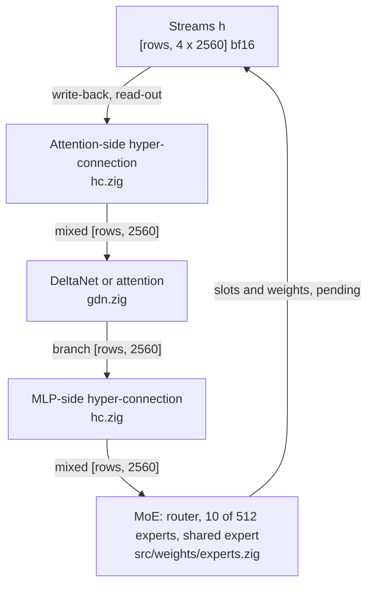

# `zig/src/models/qwen4/` reference

Read when a task touches what a section names; the `AGENTS.md` beside this file binds every task here.

## The map

- `config.zig`, `layout.zig`: `config.json` into sizes; every tensor resolved by name, no copy, no upload
  (`layout_builder.zig`: the resolving and its checks, `Site`). `layout.storageFor` decides a load's caches.
- `model.zig`: the weights on the device, the MTP head (`Mtp`) and the draft head (`DraftHead`); `model_load.zig`: the loader's helpers.
- `blocks/`: `hc.zig`, `gdn.zig`, `attention.zig` (`attention_cache.zig`), `moe.zig`, `ple.zig`: a block a
  file, with its wrappers; `state.zig`: a sequence's windows. Of what is above them they import `config.zig`,
  `layout.zig` alone.
- `forward.zig`: `forward`, `commit`, `Graphs` (`forward_graphs.zig`); `forward_state.zig`: a sequence's state and
  buffers; `snapshot.zig`: `Snapshot`. `taps.zig`: DFlash2 completed-layer stream means (spec 122);
  `Buffers.setTaps` reserves bf16 [rows, 5 x hidden]; `compute` writes them after an explicit MoE writeback.
- `compare.zig`: the forward against TensorFold's reference, the tolerances (`Bounds`).
- `draft.zig`, `mtp.zig`: `decode/draft.zig`'s decoder over this model (`namespace`), under callers' names
  (`Decoder`, `Chooser`, `Drafter`, `Chain`), and the MTP head, its drafter. `Chooser.accept` keeps a
  window's rows, `Chain` steps a stream's drafts, `mtp_rule.Rule` chooses them, in a session as in the pool.
- `dflash2/`: the stored-BF16 DFlash2 drafter (spec 122): `config.zig` the shared schema with Qwen's stored
  window, `weights.zig` BF16 linears through the shared kinds, `drafter.zig` over captured taps (`Buffers.setTaps`;
  `initHeld` over `Held` ranks, each rank's own embedding, halved head and taps), `seats.zig` in the hall,
  `rig.zig` session/`generate drafter=DIR`. Drafts propose; the target chooses. Two ranks in one process is the
  NCCL reference (`ranks_loopback_test.zig`); rank 1 replays `Op.flash_*` (`session/mirror.zig`) and proposes nothing.
- `session/`: `session.zig`: replies in turn, prefix reuse, snapshots (`session_options.zig`, `session_marks.zig`,
  `session_resume.zig`: where a prompt goes on from and the states kept; `session_handover.zig`: what the pool
  takes over);
  `parked.zig`: sequences left; `learnt.zig`: on disk; `chat.zig`: a
  reply's text (`Speaker`); `pair.zig` (`mirror.zig`; its positions `decode/book.zig`; `pair_rounds.zig`: a reply's rounds on
  both ranks; `pair_prompt.zig`: a prompt told once): a pair's replies.
- `pool/`: `hall.zig`, `rounds.zig` (`rounds_stage.zig`, `rounds_graphs.zig`, `rounds_select.zig`; two ranks: `rounds_parts.zig`, `rounds_ranks.zig`): streams a
  round; the seats' and the round's types `hall_seats.zig`; pool `hall_engine.zig` (`hall_open.zig` opens it if it fits: `Fit`, extents, `Rest`; two ranks: `hall_ranks.zig`), its head pass `hall_head.zig` and chase `hall_chase.zig` (a chain's depth by the round's width: `hall_depth.zig`), its states `hall_keep.zig` (with a reply's stride; a session's:
  `hall_carry.zig`; on disk: `hall_spill.zig`), jobs `hall_front.zig`; warm passes (`--warm-turns`) `hall_warm.zig`.
- `served.zig`: the session, pool or pair under `server/served.zig`'s engine.
- `commands.zig`: what `zspark` dispatches by `model_type`. `commands/`: a command a file; `common.zig`;
  `serve_ranks.zig`: `serve.zig`'s half, one rank of two (pair or pool over `hall_ranks.zig`).
- `vision.zig`: the vision tower (`Tower`: load, `encode`), spec 019; `vision_ref.zig`: its kernels' f64 host
  arithmetic, for the tests.
- The tests' `testing.zig`: `random_model`, `tiny_model`, `attending` (`testing_attending.zig`), `sessions`.

## The model

48 layers over `streams` (4) residual streams of `hidden` (2,560) values, one row of 10,240. Three
DeltaNet layers, then one attention layer, repeated. The PLE (n-gram embedding) sits on layer 1 only.

A block's result is not added to the streams when it is computed. It stays pending and the next hyper-connection's
write-back applies it, with the inject gates the previous read-out produced. The last write-back happens in the
finish, before the mixer's read-out and the head.

## TensorFold sources

All under `../TensorFold/src/tensorfold/`. The forward takes the `*_nvfp4` loaders and the
`kernel == "b16"` branches.

| Here | TensorFold |
| --- | --- |
| `config.zig` | `families/qwen4_exp/cuda/weight_types.py`, `families/qwen4_exp/__init__.py` (preflight), `cuda/ngram.py` |
| `layout.zig` | `families/qwen4_exp/cuda/weights.py` (`*_nvfp4`), `reader.py`, `cuda/nvfp4/format.py` |
| `hc.zig` | `families/qwen4_exp/cuda/glue.py` (`_hc_*`) |
| `gdn.zig` | `families/qwen4_exp/cuda/gdn.cu`, `gdn.cpp`, `gdn.py` |
| `attention.zig` | `families/qwen4_exp/cuda/glue.py` (`_attn_prep`, `_attn_gate`), `attention.py`, `forward.py` (`attn_block`) |
| `attention_cache.zig` | `kvcache.py` |
| `moe.zig` | `cuda/moe.py`, `families/qwen4_exp/cuda/nvfp4_moe.py` |
| `ple.zig` | `families/qwen4_exp/cuda/glue.py` (`_ple_*`), `cuda/ngram.py`, `families/qwen4_exp/host_table.py`, `forward.py` (`ple_block`, `stage`, `commit`) |
| `state.zig` | `families/qwen4_exp/cuda/forward.py` (`_shift_windows`) |
| `model.zig` | `families/qwen4_exp/cuda/weights.py` (`*_nvfp4`, `draft_head`), `weight_types.py` (`MTPW`, `draft_token_ids`), `draft_vocab.txt` |
| `mtp.zig`, `mtp_rule.zig`, `draft.zig` | `families/qwen4_exp/cuda/mtp.py`, `decode.py` (`absorb`, `draft`, `mtp_decode`) |
| `../../requantize.zig` | `cuda/nvfp4/experts.py` (`quantize`), `families/qwen4_exp/cuda/weights.py` (`weight_bf16`, `moe_nvfp4`'s `fp8_drafter`) |
| `forward.zig`, `forward_state.zig` | `families/qwen4_exp/cuda/forward.py`, `state.py` |
| `vision.zig` | transformers 5.18's `models/qwen3_5/modeling_qwen3_5.py` (`Qwen3_5VisionModel`) as `vision/qwen_cuda.py` runs it |

## Two ranks

- A rank (`share.zig`) holds half the DeltaNet and attention heads, expert width and `lm_head`; the MTP
  head whole on rank 0 (`Mtp.whole`, `mtp.over`) or half a rank (`mtp_ranks.zig`, `ZSPARK_RANKS_HEAD`).
  `partial.cu` adds fp32 partials rank 0 first.
- The cut is on the layout's tensors (`share_layout.zig`), for BF16, MXFP8 (codes and exponents alike) and
  NVFP4; csf scales stay whole and a rank decodes its window at load (`layout.Csf.window`, spec 105
  WS-04). The n-gram table is whole on each rank, read from the mapping, NVFP4 or not.
- A pair chooses a prompt's tokens into rows as wide as its window on both ranks (`Pair.chosen`, at most
  `Rounds.kept_most`, what the first `Op.decode` frame carries): a turn's new tokens are one window, as
  `session.zig`'s. Into 16 rows a turn of 17 or more ran a second window, 35 to 60 ms (spec 110 WS-02).
- A pair's prompt windows are `--max-num-batched-tokens`'s as one Spark's (spec 111), unset `session.promptRows` (2,048; one Spark's lone stream 4,096 since spec 148): its
  frames are `Lead.widest`, a 4,096-row window told a pass or its rows chosen beside `Op.decode`'s arguments
  (`kept_most` 8,228 since spec 149 WS-06 widened it for the pool's 4,096-row rounds and their next chunk's tokens); `Lead.most` stays GLM's. Until spec 111 they were 512 rows, a frame of 1,024 tokens.
  `ranks-check ... windows` holds 2,048-row windows to 512-row ones and serial steps in bits.
- A pair scores what one rank's session does (`Pair.create`: a prompt's last row, a round's 16 at most) and
  keeps the rows each layer keeps (`forward.keptRows`), as a session: the states inside a window wider than
  that are asked of both ranks before it runs (`Pair.askWithin`, `Op.keep_ahead`; on the told-once path rank
  1 reads them from the frames' `due`), each then `Op.keep_within`; a narrower window's are taken after it ran
  (`Snapshot.within`). Until then a pair kept every row of a window, about 1 GiB a rank at 2,048 rows
  (spec 111 WS-02, fn-tails). A check that reads every row's logits makes its pair with `createScoring`. Its
  prompt's next window is said to the buffers (`Pair.Ahead`, `H.expect`) on both ranks, its table rows
  gathered while the device computes, as a session's (spec 087).
- A checkpoint no TensorFold reads is held on two ranks to the vLLM container's replies and scores
  (`checks/ranks_vllm.zig`, the bounds of `checks/vllm_reference.zig`, one Spark's).
